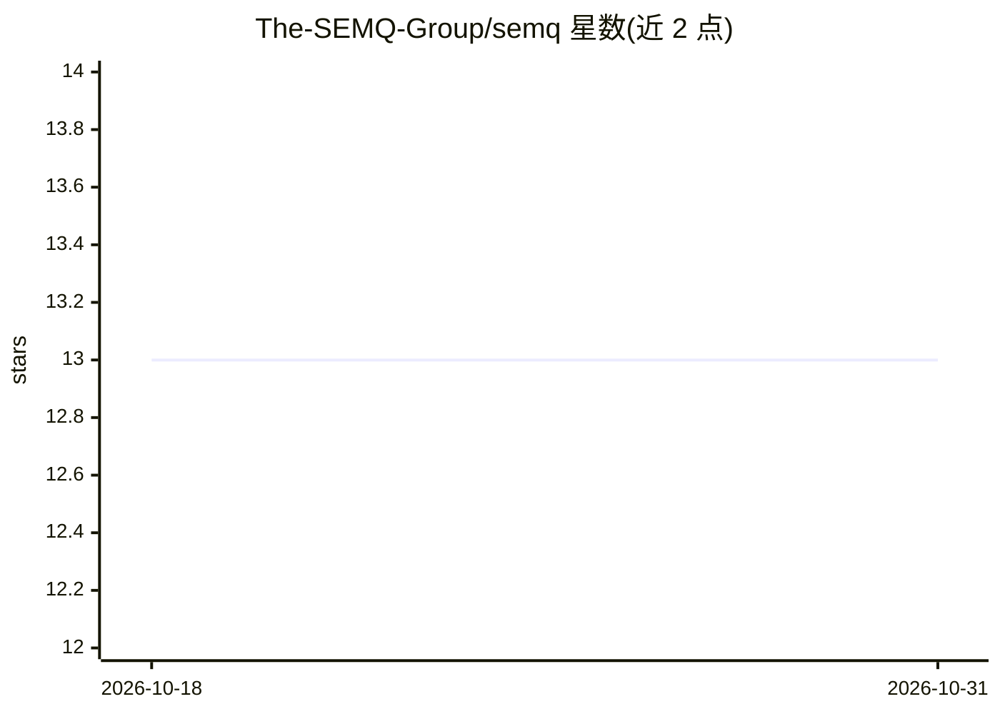

# The-SEMQ-Group/semq

⭐ 13 · Python · NOASSERTION · 推送 2026-10-29 · [GitHub](https://github.com/The-SEMQ-Group/semq) · [官网](https://thesemqgroup.ai) · 组织维护

**嵌入向量的确定性符号编码库：跨语言字节一致、可 diff 可验证**

面向嵌入/特征管线的 SDK：将单位化 float32 向量编码为紧凑符号行，生成带 SHA-256 身份的 Encoding 状态，用 diff 定位新增/删除/变更行，用 Floor 基线门控重建是否处于噪声范围内。C 核心配 Python/Rust/Go/TypeScript 绑定，相同输入在支持平台产出字节一致的行，CI 用共享一致性向量校验。明确不做：不生成嵌入、不训练、不归一化、不搜索。Rust/Go 安装需 C 编译器，采用 PolyForm Noncommercial 许可。

## 筛选速览

| 维度 | 判定 | 备注 |
|---|---|---|
| AI 角色 | `ai-ecosystem` | LLM/agent 周边工具 |
| 许可风险 | `none` | NOASSERTION |
| 部署形态 | `library` | 以包/库形式分发 |
| 模型依赖 | — | README 未给出锁定关系 |
| 硬件要求 | — | 无带数字的原话,不猜 |
| 安装摩擦 | `medium` | 含编译或系统依赖之一 |
| 成熟度 | — | 结构信号不足 |

## 能力要点

- float32 向量→符号行，SHA-256 内容寻址的 state_id
- 跨语言/跨平台字节一致，CI 共享一致性向量校验
- diff 定位变更行（含 Hamming 距离）+ Floor 重建门控
- 四种语言绑定 + .semq 文件格式（加载前校验）

## 适用场景

- 重新嵌入语料库后核验哪些行受影响
- 跨设备/批次重建嵌入时的变更审计
- RAG 管线中对嵌入重建做可复现的质量门控

## 场景标签

`模型量化` · 领域:训练与推理

## 证据(README 行号)

> L15: SEMQ turns unit-norm `float32` vectors produced by your embedding or feature
> L36: SEMQ does not generate embeddings, train a model, normalize vectors, or

## 星数曲线

2026-10-18 13 → 2026-10-31 13（+0）

---
*卡片 v1 · prompt 1.4 · 生成 2026-10-31 · 置信度 high · 依据 README sha `b800c70ee4a9` · [字段定义](../../DATASET.md)*
