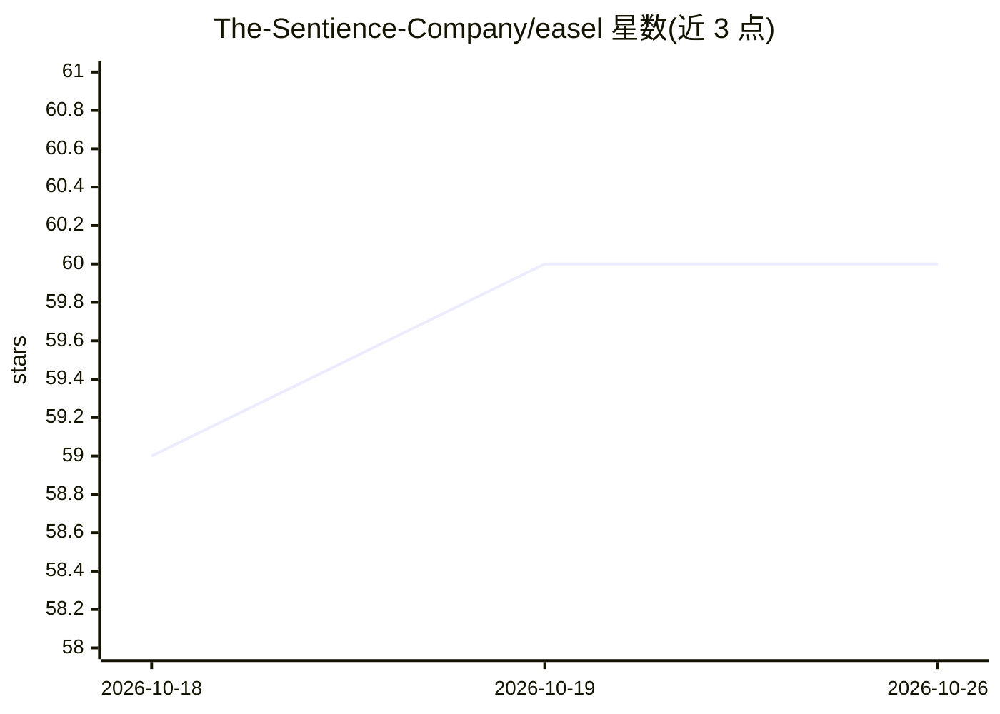

# The-Sentience-Company/easel

⭐ 60 · JavaScript · Apache-2.0 · 推送 2026-10-22 · [GitHub](https://github.com/The-Sentience-Company/easel) · [官网](https://github.com/The-Sentience-Company/easel#readme) · 组织维护

**本地人机审核看板：agent 发布工作，人批注，反馈以 JSON 回流**

面向使用 AI agent 的开发者的本地审核工具：agent 通过 CLI 将计划、评估结果、设计等工作发布为浏览器看板，人在页面上对任意元素批注、投票或决策，点击 Send 后阻塞中的 `easel await` 以 JSON 返回反馈；agent 应用反馈后可重发布为新一轮，附带 diff 标记。由本地 `easeld` 守护进程管理状态，支持看板在会话与重启间存续。要求 macOS 与 Node 22+，安装时经 Puppeteer 拉取 Chromium（约 1GB）。提供 8 种看板模板、Mermaid 图渲染为可编辑白板、聊天与按 agent id 的反馈游标机制。

## 筛选速览

| 维度 | 判定 | 备注 |
|---|---|---|
| AI 角色 | `ai-ecosystem` | LLM/agent 周边工具 |
| 许可风险 | `permissive` | Apache-2.0 |
| 部署形态 | `library` | 以包/库形式分发 |
| 模型依赖 | — | README 未给出锁定关系 |
| 硬件要求 | — | 无带数字的原话,不猜 |
| 安装摩擦 | `low` | 无编译、无系统依赖或容器化 |
| 成熟度 | — | 结构信号不足 |

## 能力要点

- agent 发布—人批注—JSON 反馈回流—带 diff 重发布的多轮闭环
- 本地 easeld 守护进程持有全部状态，看板跨会话与重启存续
- 8 种模板（review/eval/compare/replay/gallery/rulings/queue/page）
- 任意元素批注带两字符锚点（A1/A2…），Mermaid 图可编辑为 Excalidraw 白板

## 适用场景

- 审核 agent 产出的计划、评估结果或设计稿并精确给反馈
- 对多版本生成结果做并排对比与逐案裁决
- 让 agent 阻塞等待人工决策后再继续执行

## 场景标签

 · 领域:AI agent 工作流/人机协作

## 证据(README 行号)

> L9: The agent publishes a page. You open it in a browser, annotate anything on it, and click Send. The agent — which has
> L30: easel await <key> --agent my-project:claude    # blocks until you send feedback
> L100: |`skills/`|the agent-side guide — how an agent drives all of the above|

## 星数曲线

2026-10-18 59 → 2026-10-26 60（+1）

---
*卡片 v1 · prompt 1.4 · 生成 2026-10-24 · 置信度 high · 依据 README sha `d222e5ba2109` · [字段定义](../../DATASET.md)*
