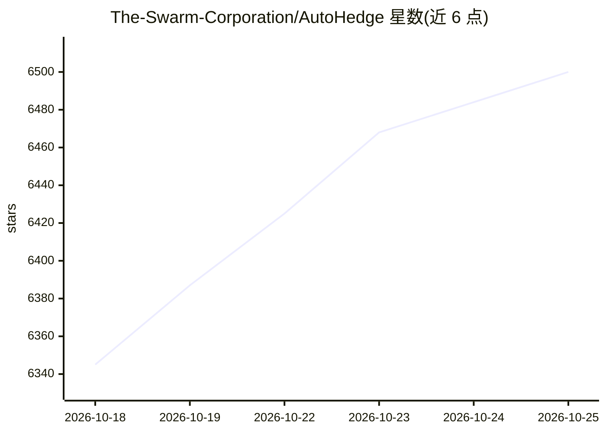

# The-Swarm-Corporation/AutoHedge

⭐ 6,500 · Python · MIT · 推送 2026-05-11 · [GitHub](https://github.com/The-Swarm-Corporation/AutoHedge) · [官网](https://swarms.xyz/) · 组织维护

**自主交易的多 agent 对冲基金框架，自动分析并执行交易**

基于多智能体架构的自主对冲基金系统：Director、Quant、Risk Management、Execution 四类专职 agent 依次完成策略生成、技术与统计分析、仓位与风险评估、订单执行，输出 JSON 结构化建议并记录审计日志。当前支持 Solana 上的全自动交易，Coinbase 及其他中心化交易所列于规划中。通过 pip 安装，需配置 Jupiter API 等环境变量，运行一条命令即可启动，设计面向机构级可靠性场景。

## 筛选速览

| 维度 | 判定 | 备注 |
|---|---|---|
| AI 角色 | `ai-native` | 本体是模型或模型工具 |
| 许可风险 | `permissive` | MIT |
| 部署形态 | `library` | 以包/库形式分发 |
| 模型依赖 | — | README 未给出锁定关系 |
| 硬件要求 | — | 无带数字的原话,不猜 |
| 安装摩擦 | `low` | 无编译、无系统依赖或容器化 |
| 成熟度 | — | 结构信号不足 |

## 能力要点

- Director/Quant/Risk/Execution 四类专职 agent 流水线
- 内置仓位 sizing 与风险优先的执行前风控
- JSON 结构化输出与可配置的企业级审计日志
- 实时市场数据接入（Jupiter API）

## 适用场景

- 在 Solana 上跑全自动多 agent 交易
- 以模块化框架扩展自定义策略与新增交易场所
- 获取结构化交易建议供下游系统使用

## 场景标签

`多智能体` `金融量化` · 领域:Agent 开发

## 证据(README 行号)

> L5: AutoHedge is an enterprise-grade autonomous agent hedge fund that trades on your behalf. It combines swarm intellige
> L15: - **Multi-Agent Architecture**: Specialized agents for each stage of the trading pipeline

## 星数曲线

2026-10-18 6,345 → 2026-10-25 6,500（+155）

---
*卡片 v1 · prompt 1.4 · 生成 2026-10-20 · 置信度 high · 依据 README sha `71aa98dead4e` · [字段定义](../../DATASET.md)*
