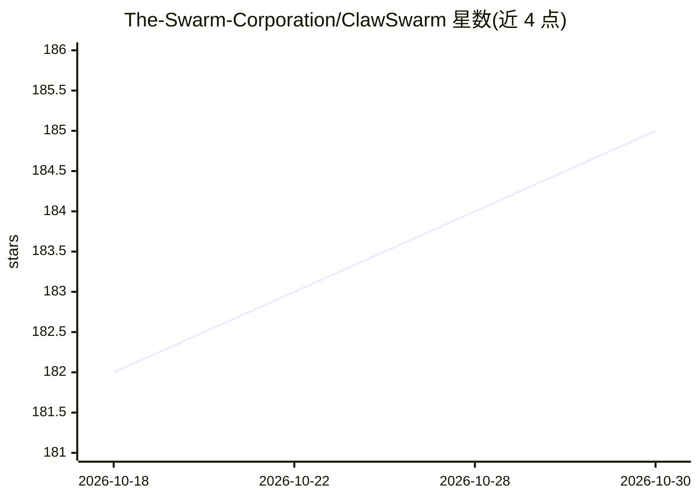

# The-Swarm-Corporation/ClawSwarm

⭐ 185 · Python · Apache-2.0 · 推送 2026-09-14 · [GitHub](https://github.com/The-Swarm-Corporation/ClawSwarm) · [官网](https://swarms.ai) · 组织维护

**多 agent 个人助理：统一 Telegram/Discord/WhatsApp 消息接入**

基于 Swarms 框架的多 agent 个人生产力系统：gRPC 网关统一接入 Telegram、Discord、WhatsApp，将消息归一化后交给 director agent 规划并分派给专职 worker（回复、搜索、代币发行、Claude Code 编码），再由 Summarizer 压缩为聊天回复送回原渠道。对话历史持久化为 markdown 文件，超长时用嵌入+RAG 检索。默认模型为 OpenAI gpt-4o-mini，支持 vLLM/HuggingFace 本地模型替换；pip 安装，需配置各平台凭据。面向想自建跨平台消息 agent 的用户。

## 筛选速览

| 维度 | 判定 | 备注 |
|---|---|---|
| AI 角色 | `ai-native` | 本体是模型或模型工具 |
| 许可风险 | `permissive` | Apache-2.0 |
| 部署形态 | `self-host` | docker 或自建部署 |
| 模型依赖 | local-ok | 支持本地模型 |
| 硬件要求 | — | 无带数字的原话,不猜 |
| 安装摩擦 | `low` | 无编译、无系统依赖或容器化 |
| 成熟度 | — | 结构信号不足 |

## 能力要点

- director+worker 层级多 agent 架构，director 经 SwarmSpec 分派任务
- gRPC 网关统一归一化三个消息平台，可加 TLS
- 持久化 markdown 记忆，超上下文时切换嵌入+RAG 检索
- 支持 vLLM / HuggingFace Transformers 本地模型替换云端模型

## 适用场景

- 在 Telegram/Discord/WhatsApp 上部署统一的个人 AI 助理
- 用本地模型（vLLM 或 Transformers）替代云端模型运行
- 通过 Claude Code worker 让 agent 执行代码实现与调试任务

## 场景标签

`多智能体` `AI 助手` · 领域:Agent 开发

## 证据(README 行号)

> L26: **ClawSwarm** is a multi-agent personal productivity operating system powered by hundreds of agents designed to enh
> L108: |**Hierarchical multi-agent architecture**|A **director** agent (ClawSwarm) receives each message, creates a plan,

## 星数曲线

2026-10-18 182 → 2026-10-30 185（+3）

---
*卡片 v1 · prompt 1.4 · 生成 2026-10-22 · 置信度 mid · 依据 README sha `2652fcc4fe3e` · [字段定义](../../DATASET.md)*
