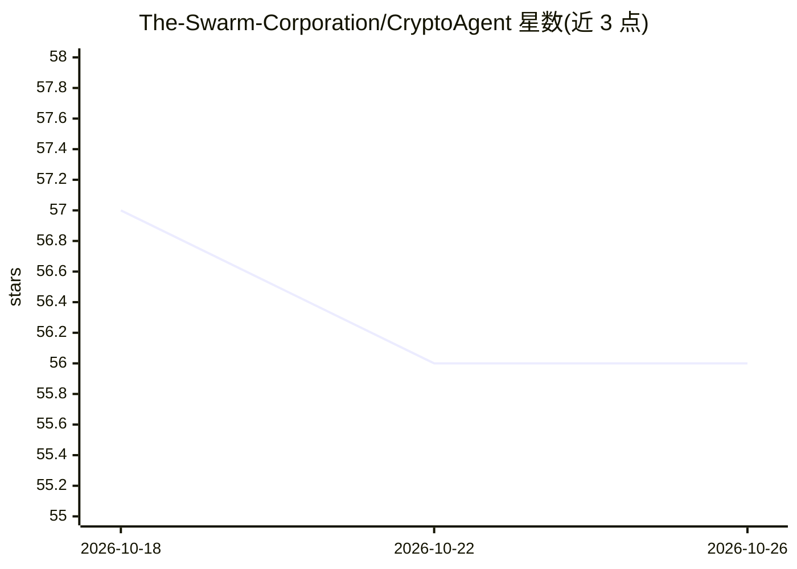

# The-Swarm-Corporation/CryptoAgent

⭐ 56 · Python · MIT · 推送 2026-07-27 · [GitHub](https://github.com/The-Swarm-Corporation/CryptoAgent) · [官网](https://discord.com/servers/agora-999382051935506503) · 组织维护

**加密货币数据抓取与 AI 分析报告生成工具**

基于 swarms 框架构建的加密货币分析 agent：通过 CoinGecko 等 API 获取实时价格、市值、交易量、供给与涨跌数据，调用 OpenAI 语言模型生成面向投资者与金融分析师的摘要报告。以 Python 包形式发布（pip 安装），需在 .env 中配置 OpenAI、CoinMarketCap、Etherscan 的 API key；支持错误处理、重试与日志机制，可通过修改系统提示词定制分析。多币种同时分析、情绪分析与预测分析列为未来增强项，尚未实现。

## 筛选速览

| 维度 | 判定 | 备注 |
|---|---|---|
| AI 角色 | `ai-native` | 本体是模型或模型工具 |
| 许可风险 | `permissive` | MIT |
| 部署形态 | `library` | 以包/库形式分发 |
| 模型依赖 | — | README 未给出锁定关系 |
| 硬件要求 | — | 无带数字的原话,不猜 |
| 安装摩擦 | `low` | 无编译、无系统依赖或容器化 |
| 成熟度 | — | 结构信号不足 |

## 能力要点

- 通过 CoinGecko API 抓取价格、市值、交易量、供给与涨跌等实时数据
- 调用 OpenAI 语言模型生成加密货币摘要报告
- 内置错误处理、重试与日志机制
- 支持修改系统提示词定制分析场景

## 适用场景

- 追踪指定加密货币的实时价格与关键指标
- 为投资研究生成特定币种的趋势报告
- 机构或个人投资者批量获取市场数据摘要

## 场景标签

`金融量化` · 领域:学习与行业

## 证据(README 行号)

> L5: CryptoAgent is a professional, enterprise-grade solution designed to fetch, analyze, and summarize real-time cryptoc
> L47: - **CryptoAgentAgent** performs the crypto analysis by combining data fetched from the API with OpenAI's powerful l

## 星数曲线

2026-10-18 57 → 2026-10-26 56（-1）

---
*卡片 v1 · prompt 1.4 · 生成 2026-10-24 · 置信度 high · 依据 README sha `ab06f4f2d04b` · [字段定义](../../DATASET.md)*
