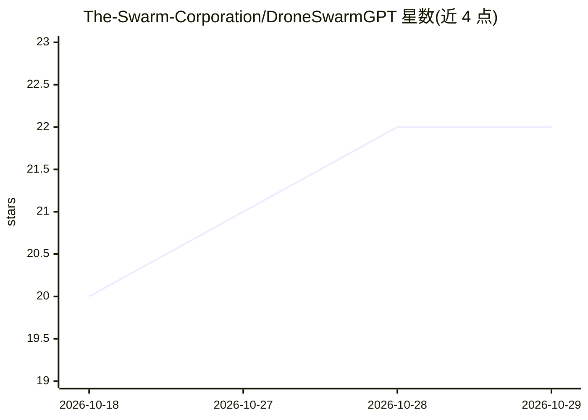

# The-Swarm-Corporation/DroneSwarmGPT

⭐ 22 · Python · MIT · 推送 2025-12-15 · [GitHub](https://github.com/The-Swarm-Corporation/DroneSwarmGPT) · [官网](https://swarms.xyz/) · 组织维护

**面向企业与政府的无人机集群自然语言控制系统**

由 The Swarm Corporation（swarms.ai）开发的自主无人机集群控制系统，基于多模态 transformer 技术。功能包括：自然语言指令的任务规划与执行、视觉/视频/空间/语言多模态输入处理、动态编队控制、协同任务执行、实时监控与故障安全机制。目标用户为企业与政府场景，如基础设施巡检、搜救、农业监测、安防等。通过 pip 安装，要求 Python 3.12+、PyTorch 2.0+、CUDA GPU（推荐）、16GB 内存起步；商用部署需联系获取许可。

## 筛选速览

| 维度 | 判定 | 备注 |
|---|---|---|
| AI 角色 | `ai-native` | 本体是模型或模型工具 |
| 许可风险 | `permissive` | MIT |
| 部署形态 | `library` | 以包/库形式分发 |
| 模型依赖 | — | README 未给出锁定关系 |
| 硬件要求 | — | 无带数字的原话,不猜 |
| 安装摩擦 | `medium` | 含编译或系统依赖之一 |
| 成熟度 | — | 结构信号不足 |

## 能力要点

- 自然语言接口用于任务规划与执行
- 视觉/视频/空间/语言多模态输入处理
- 动态编队控制与协同任务执行
- 故障安全机制与端到端加密、基于角色的访问控制

## 适用场景

- 用自然语言指挥多架无人机协同执行巡检或搜救任务
- 农业、环境与安防场景的无人机集群监控
- 需要审计日志与合规特性的政府/企业无人机部署

## 场景标签

`多智能体` `多模态` · 领域:Agent 开发

## 证据(README 行号)

> L9: DroneSwarmGPT is an enterprise-grade autonomous drone swarm control system powered by advanced multi-modal transform
> L45:  - Natural language command interpretation

## 星数曲线

2026-10-18 20 → 2026-10-29 22（+2）

---
*卡片 v1 · prompt 1.4 · 生成 2026-10-28 · 置信度 mid · 依据 README sha `02b827096fc6` · [字段定义](../../DATASET.md)*
