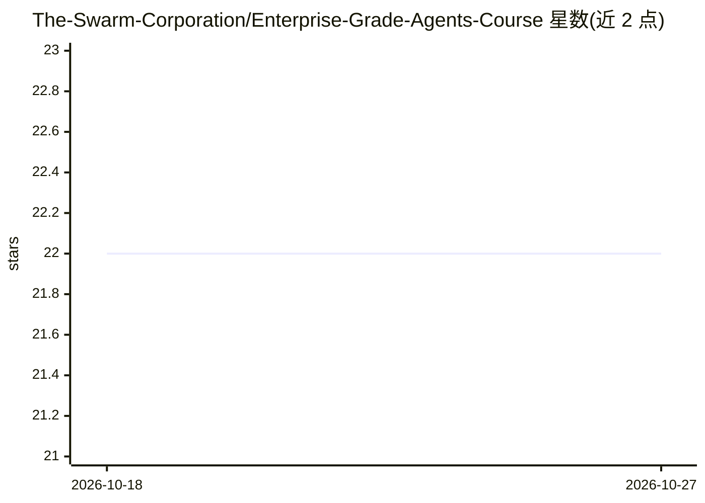

# The-Swarm-Corporation/Enterprise-Grade-Agents-Course

⭐ 22 · Python · MIT · 推送 2025-12-22 · [GitHub](https://github.com/The-Swarm-Corporation/Enterprise-Grade-Agents-Course) · [官网](https://discord.com/servers/agora-999382051935506503) · 组织维护

**面向企业场景的自主 agent 开发课程（8 周制）**

The-Swarm-Corporation 发布的 8 周（24 学时）课程，教授使用 Swarms 库构建、部署与运维企业级自主 agent。内容涵盖 agent 架构与记忆系统、工具集成与函数调用、文档与多模态处理、企业系统集成、并发与性能优化、监控运维及生产部署，每周含实践练习。考核包括周作业、期中期末项目，通过（≥75 分）可获结业证书。前置要求：中级 Python、LLM 基础概念与企业软件开发经验。

## 筛选速览

| 维度 | 判定 | 备注 |
|---|---|---|
| AI 角色 | `ai-knowledge` | 知识聚合/清单类 |
| 许可风险 | `permissive` | MIT |
| 部署形态 | `None` |  |
| 模型依赖 | — | README 未给出锁定关系 |
| 硬件要求 | — | 无带数字的原话,不猜 |
| 安装摩擦 | `low` | 无编译、无系统依赖或容器化 |
| 成熟度 | — | 结构信号不足 |

## 能力要点

- 8 个模块覆盖 agent 构建、工具集成、扩展、监控到生产部署全流程
- 每周配实践练习，含期末端到端企业 agent 项目
- 通过考核（75 分）颁发结业证书
- 配套周度答疑、论坛与代码评审等社区支持

## 适用场景

- 系统学习用 Swarms 库构建企业 agent 工作流
- 为团队培训 LLM agent 的开发与生产化能力
- 了解企业 agent 的记忆、工具调用与部署模式

## 场景标签

`教程课程` · 领域:学习与行业

## 证据(README 行号)

> L7: This comprehensive course teaches students how to build, deploy, and manage autonomous agents for enterprise workflo
> L160:  - Swarms documentation

## 星数曲线

2026-10-18 22 → 2026-10-27 22（+0）

---
*卡片 v1 · prompt 1.4 · 生成 2026-10-27 · 置信度 high · 依据 README sha `cae02e104965` · [字段定义](../../DATASET.md)*
