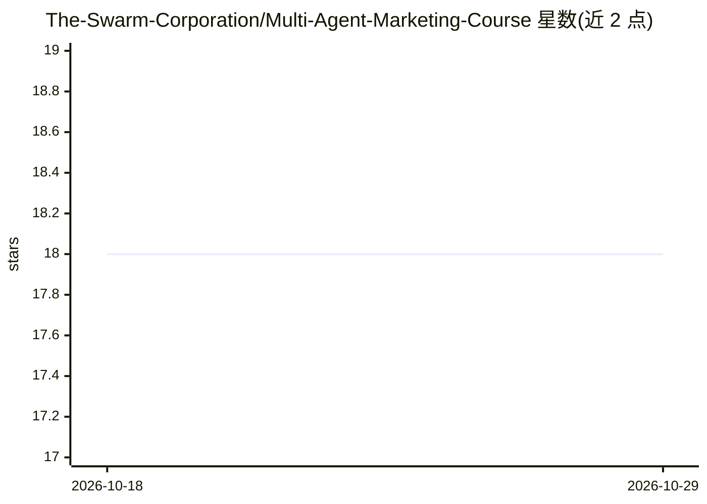

# The-Swarm-Corporation/Multi-Agent-Marketing-Course

⭐ 18 · Jupyter Notebook · MIT · 推送 2025-12-08 · [GitHub](https://github.com/The-Swarm-Corporation/Multi-Agent-Marketing-Course) · [官网](https://discord.com/servers/agora-999382051935506503) · 组织维护

**教你用 Swarms 框架构建营销多智能体系统的 8 周课程**

由 Swarms Corporation 提供的实操课程：教授使用 Swarms 框架构建面向营销的自主智能体与多智能体系统，覆盖社交媒体代理、内容生成、营销分析、活动优化等模块，含实战项目、每周作业与结业证书。技术上要求 Python 3.10+、安装 Swarms 库、配置 OpenAI API key（Anthropic 可选）与社交媒体 API 令牌。课程为期 8 周，每周直播 2 小时，预计每周投入 10-15 小时。

## 筛选速览

| 维度 | 判定 | 备注 |
|---|---|---|
| AI 角色 | `ai-knowledge` | 知识聚合/清单类 |
| 许可风险 | `permissive` | MIT |
| 部署形态 | `library` | 以包/库形式分发 |
| 模型依赖 | — | README 未给出锁定关系 |
| 硬件要求 | — | 无带数字的原话,不猜 |
| 安装摩擦 | `low` | 无编译、无系统依赖或容器化 |
| 成熟度 | — | 结构信号不足 |

## 能力要点

- 基于 Swarms 框架的多智能体营销自动化教学
- 覆盖社交媒体/内容生成/分析/活动优化四类代理
- 含 3 个实战项目、作业与结业证书
- 8 周课程，提供 Discord 社区与每周答疑

## 适用场景

- 学习搭建管理多社交账号的多智能体系统
- 构建自动化内容生成与分发流水线
- 掌握营销数据分析与活动优化的 agent 编排

## 场景标签

`教程课程` `多智能体` · 领域:Agent 开发

## 证据(README 行号)

> L5: This course teaches you how to leverage the Swarms framework to build sophisticated multi-agent systems for marketin
> L26: ### 📋 Course Outline

## 星数曲线

2026-10-18 18 → 2026-10-29 18（+0）

---
*卡片 v1 · prompt 1.4 · 生成 2026-10-29 · 置信度 high · 依据 README sha `e59b3aa6affe` · [字段定义](../../DATASET.md)*
