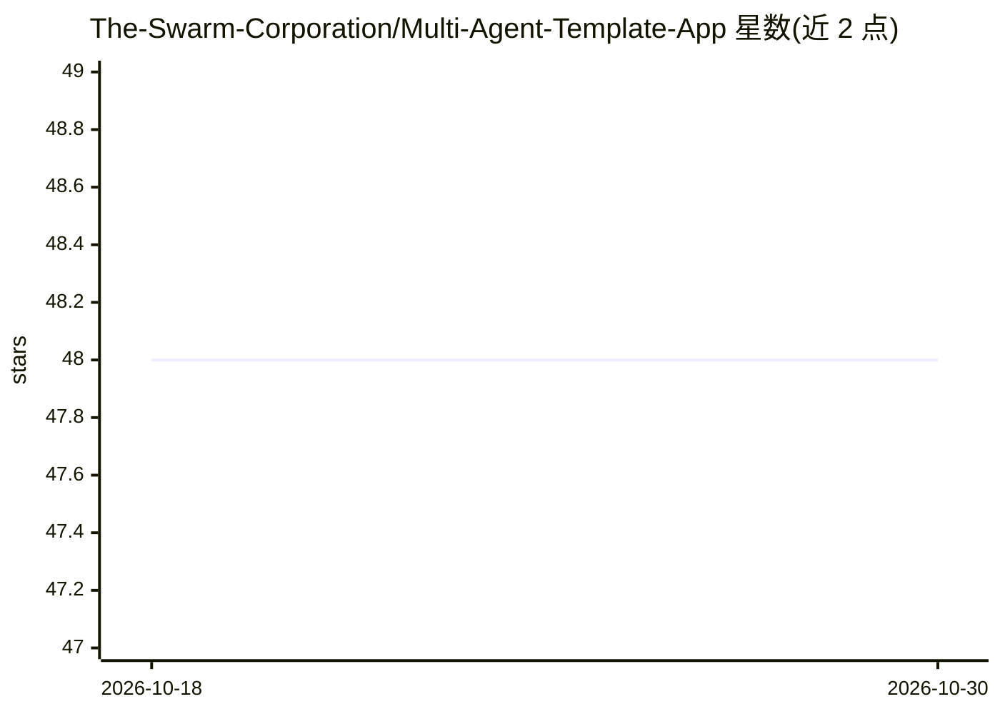

# The-Swarm-Corporation/Multi-Agent-Template-App

⭐ 48 · Shell · MIT · 推送 2025-12-08 · [GitHub](https://github.com/The-Swarm-Corporation/Multi-Agent-Template-App) · [官网](https://github.com/kyegomez/swarms) · 组织维护

**供开发者快速搭建多智能体应用的模板项目**

由 Swarms 公司（The Swarm Corporation）维护的多智能体应用模板：供开发者以此为基础快速开始构建多智能体应用。README 主要覆盖工程配套内容：pip 安装依赖、black/ruff 代码质量检查、pytest 测试、poetry 发布到 PyPI 的流程、GitHub Actions CI/CD、MK Docs 文档配置，采用 MIT 许可。README 未展开描述具体的智能体编排机制或示例功能。

## 筛选速览

| 维度 | 判定 | 备注 |
|---|---|---|
| AI 角色 | `ai-ecosystem` | LLM/agent 周边工具 |
| 许可风险 | `permissive` | MIT |
| 部署形态 | `library` | 以包/库形式分发 |
| 模型依赖 | — | README 未给出锁定关系 |
| 硬件要求 | — | 无带数字的原话,不猜 |
| 安装摩擦 | `low` | 无编译、无系统依赖或容器化 |
| 成熟度 | — | 结构信号不足 |

## 能力要点

- 多智能体应用的项目模板与目录结构
- 内置代码质量检查（black/ruff/PEP8）与 pytest 测试配置
- 提供 poetry 发布到 PyPI 与 GitHub Actions CI/CD 流程
- 内置 MK Docs 文档与 readthedocs 配置

## 适用场景

- 作为起点快速搭建多智能体应用工程
- 复用其测试与 CI/CD 配置发布自有 Python 包

## 场景标签

`多智能体` `Agent 框架` · 领域:Agent 开发

## 证据(README 行号)

> L3: # Multi-Agent Template App
> L7: A radically simple, reliable, and high performance template to enable you to quickly get set up building multi-agent

## 星数曲线

2026-10-18 48 → 2026-10-30 48（+0）

---
*卡片 v1 · prompt 1.4 · 生成 2026-10-25 · 置信度 mid · 依据 README sha `225a939a8628` · [字段定义](../../DATASET.md)*
