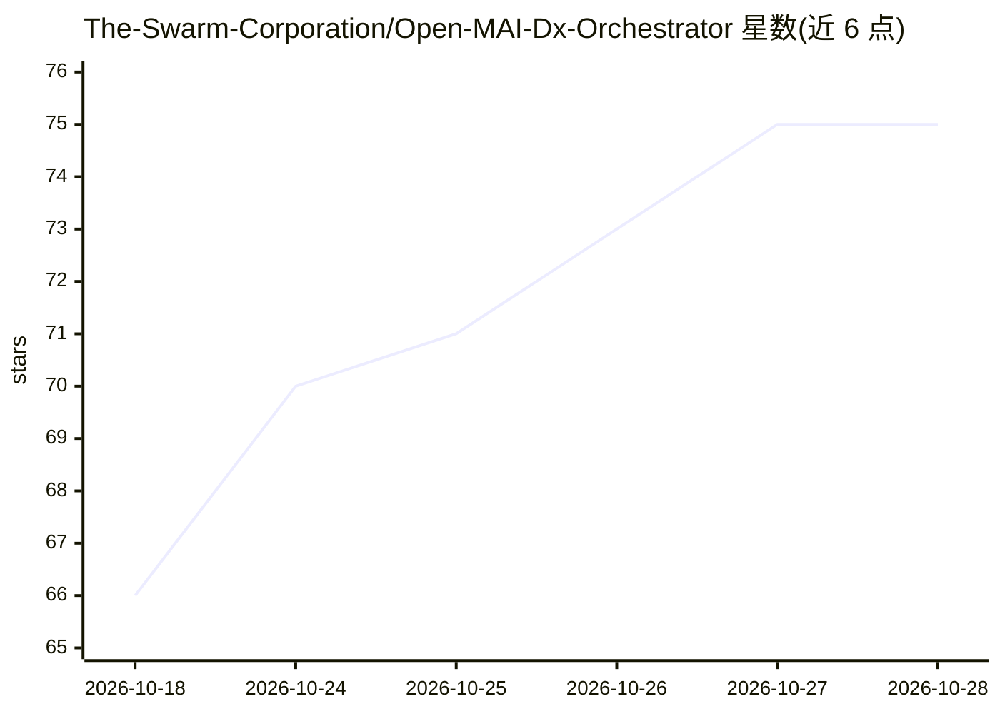

# The-Swarm-Corporation/Open-MAI-Dx-Orchestrator

⭐ 75 · Python · MIT · 推送 2026-07-27 · [GitHub](https://github.com/The-Swarm-Corporation/Open-MAI-Dx-Orchestrator) · [官网](https://swarms.ai) · 组织维护

**微软 Sequential Diagnosis 论文的开源多智能体医学诊断实现**

基于 Swarms 框架对微软研究院论文 Sequential Diagnosis with Language Models 的开源实现：8 个医师角色 agent 组成虚拟诊断小组，进行迭代式医疗诊断，涵盖假设维护、检查选择、偏倚防范、成本管控、共识综合与准确率评分等角色。支持 5 种运行模式（即时、仅提问、预算、无预算、集成）与 25+ 医学检查的实时成本追踪；模型无关，可通过环境变量接入 OpenAI、Gemini、Anthropic 等模型。以 pip 包形式提供，MIT 许可。

## 筛选速览

| 维度 | 判定 | 备注 |
|---|---|---|
| AI 角色 | `ai-native` | 本体是模型或模型工具 |
| 许可风险 | `permissive` | MIT |
| 部署形态 | `library` | 以包/库形式分发 |
| 模型依赖 | — | README 未给出锁定关系 |
| 硬件要求 | — | 无带数字的原话,不猜 |
| 安装摩擦 | `low` | 无编译、无系统依赖或容器化 |
| 成熟度 | — | 结构信号不足 |

## 能力要点

- 8 个专科角色 agent 组成虚拟医师小组
- 5 种运行模式与 25+ 医学检查的实时成本追踪
- 5 分制诊断准确率评分与详细反馈
- 模型无关：支持 GPT、Gemini、Claude 等

## 适用场景

- 复现论文的序贯诊断方法论
- 研究多 agent 医疗诊断与成本优化
- 作为医学诊断 agent 系统的实验基础

## 场景标签

`多智能体` `科研工具` · 领域:Agent 开发

## 证据(README 行号)

> L3: > **An open-source implementation of Microsoft Research's "Sequential Diagnosis with Language Models" paper, built w
> L5: MAI-DxO (MAI Diagnostic Orchestrator) is a sophisticated AI-powered diagnostic system that simulates a virtual panel
> L13: - **8 AI Physician Agents**: Specialized roles for comprehensive diagnosis.

## 星数曲线

2026-10-18 66 → 2026-10-28 75（+9）

---
*卡片 v1 · prompt 1.4 · 生成 2026-10-24 · 置信度 high · 依据 README sha `6fc80730160e` · [字段定义](../../DATASET.md)*
