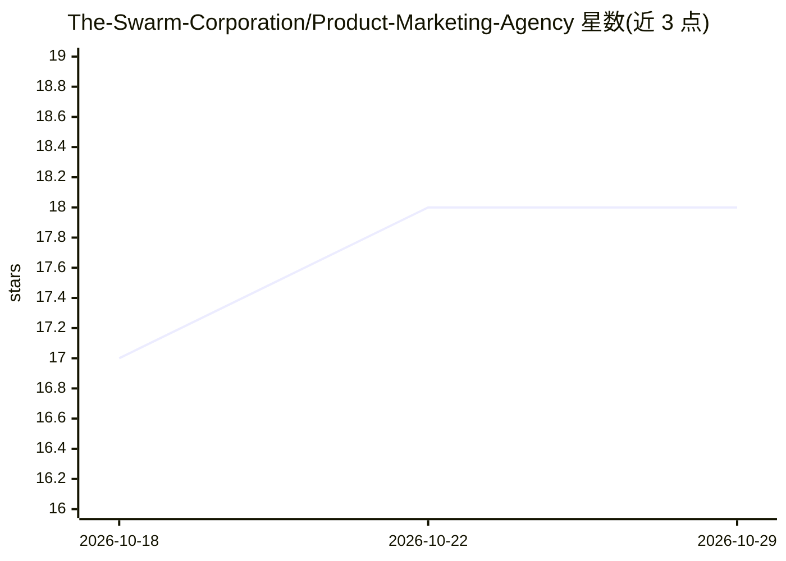

# The-Swarm-Corporation/Product-Marketing-Agency

⭐ 18 · Python · Apache-2.0 · 推送 2026-07-13 · [GitHub](https://github.com/The-Swarm-Corporation/Product-Marketing-Agency) · [官网](https://swarms.ai) · 组织维护

**基于 Swarms 框架的产品营销图片与内容生成多智能体系统**

基于 Swarms 框架构建的产品营销多智能体系统：由专门化 agent 协作生成 10 类产品营销图片（主图、开箱平铺、微距细节、色彩变体、尺寸对比、模特合成、生活场景、UGC 风格、留白横幅、搭配平铺），并提供活动报告、批量处理与交互式终端界面。面向营销内容生产场景，通过环境变量配置 OpenAI 或 Gemini API Key 使用，以 pip 安装 Python 包形式提供，MIT 许可。

## 筛选速览

| 维度 | 判定 | 备注 |
|---|---|---|
| AI 角色 | `ai-native` | 本体是模型或模型工具 |
| 许可风险 | `permissive` | Apache-2.0 |
| 部署形态 | `library` | 以包/库形式分发 |
| 模型依赖 | — | README 未给出锁定关系 |
| 硬件要求 | — | 无带数字的原话,不猜 |
| 安装摩擦 | `low` | 无编译、无系统依赖或容器化 |
| 成熟度 | — | 结构信号不足 |

## 能力要点

- 10 类专门化产品营销图片生成（主图/微距/UGC 风格等）
- 每类图片由专门 agent 负责，多智能体协作工作流
- 活动报告与分析、批量处理能力
- 交互式终端界面，支持 OpenAI 与 Gemini API Key 配置

## 适用场景

- 电商卖家批量生成多类型产品营销图片
- 为产品发布活动生成成套视觉内容与报告
- 以对话式终端界面按需生成指定类型的产品图

## 场景标签

`多智能体` `图像生成` · 领域:Agent 开发

## 证据(README 行号)

> L7: A comprehensive multi-agent system for generating professional product marketing images and content using the Swarms
> L46: ### 10 Specialized Image Types

## 星数曲线

2026-10-18 17 → 2026-10-29 18（+1）

---
*卡片 v1 · prompt 1.4 · 生成 2026-10-29 · 置信度 mid · 依据 README sha `ec797b84d480` · [字段定义](../../DATASET.md)*
