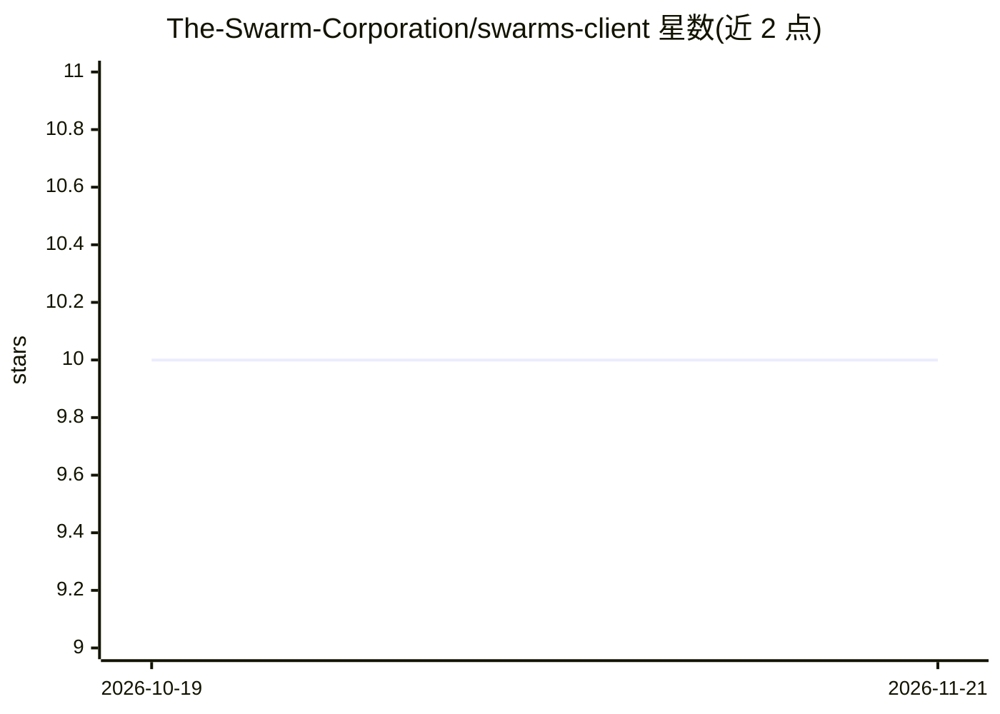

# The-Swarm-Corporation/swarms-client

⭐ 10 · Python · Apache-2.0 · 推送 2026-05-01 · [GitHub](https://github.com/The-Swarm-Corporation/swarms-client) · [官网](https://docs.swarms.ai) · 组织维护

**调用 Swarms API 的 Python 客户端，用于创建和管理 AI 集群**

Swarms API 的 Python SDK：从 Python 3.9+ 应用访问 Swarms REST API，提供全部请求参数与响应字段的类型定义，支持同步与异步客户端（基于 httpx，可选 aiohttp 后端）。内置错误分类（7 种状态码错误类型）、默认 2 次指数退避重试、超时配置、流式响应、原始响应访问及未文档化端点调用。由 Stainless 生成，PyPI 分发，需 SWARMS_API_KEY。

## 筛选速览

| 维度 | 判定 | 备注 |
|---|---|---|
| AI 角色 | `ai-ecosystem` | LLM/agent 周边工具 |
| 许可风险 | `permissive` | Apache-2.0 |
| 部署形态 | `library` | 以包/库形式分发 |
| 模型依赖 | — | README 未给出锁定关系 |
| 硬件要求 | — | 无带数字的原话,不猜 |
| 安装摩擦 | `low` | 无编译、无系统依赖或容器化 |
| 成熟度 | — | 结构信号不足 |

## 能力要点

- 同步与异步双客户端，基于 httpx，可选 aiohttp 并发后端
- 类型化请求/响应（TypedDict + Pydantic）与编辑器自动补全
- 自动重试（默认 2 次指数退避）与可配置超时
- 流式响应与未文档化端点的通用 HTTP 访问

## 适用场景

- 在 Python 应用中通过 API 创建和管理 Swarms 多智能体集群
- 需要异步高并发的服务端集成
- 对 API 调用做重试、超时与错误分类的工程化封装

## 场景标签

`多智能体` · 领域:Agent 开发

## 证据(README 行号)

> L5: The Swarms Client Python library provides convenient access to the Swarms Client REST API from any Python 3.9+
> L7: and offers both synchronous and asynchronous clients powered by httpx.
> L13: The REST API documentation can be found on docs.swarms.ai. The full API of this library can be found in api.md.

## 星数曲线

2026-10-19 10 → 2026-11-21 10（+0）

---
*卡片 v1 · prompt 1.4 · 生成 2026-11-20 · 置信度 high · 依据 README sha `67c8e19805c6` · [字段定义](../../DATASET.md)*
