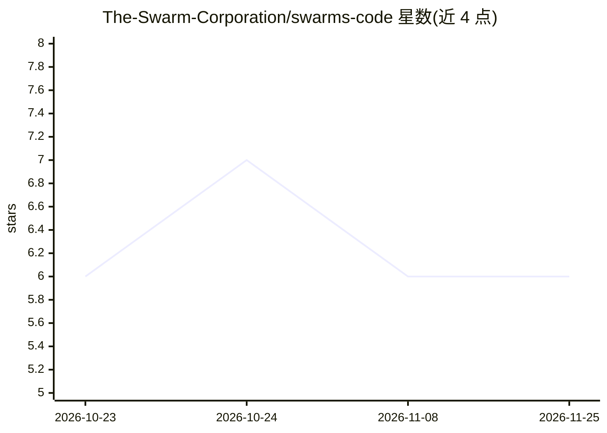

# The-Swarm-Corporation/swarms-code

⭐ 6 · Rust · Apache-2.0 · 推送 2026-10-13 · [GitHub](https://github.com/The-Swarm-Corporation/swarms-code) · [官网](https://swarms.ai) · 组织维护

**面向终端开发者的 Rust 终端编码 agent，读写代码并运行测试**

用 Rust 编写的终端编码 agent，基于 swarms-rs 构建，约 5,700 行代码、单个原生二进制、启动约 10 毫秒。读取用户代码，做最小改动解决问题，运行项目自身测试做验证。内置 8 个工具（文件读写、编辑、glob/grep 搜索、bash、todo 清单），文件编辑与 shell 命令默认先请求批准；支持 /model 会话中途切换模型、/effort 调整思考档位、SWARMS.md 等项目指令文件、.env 读取 API key。提供 git clone 源码构建与 cargo install、Docker 镜像三种安装方式。

## 筛选速览

| 维度 | 判定 | 备注 |
|---|---|---|
| AI 角色 | `ai-native` | 本体是模型或模型工具 |
| 许可风险 | `permissive` | Apache-2.0 |
| 部署形态 | `self-host` | docker 或自建部署 |
| 模型依赖 | locked-api |  |
| 硬件要求 | — | 无带数字的原话,不猜 |
| 安装摩擦 | `low` | 无编译、无系统依赖或容器化 |
| 成熟度 | — | 结构信号不足 |

## 能力要点

- 8 个工具的单 agent 循环，编辑前强制先读文件、变更后拒绝覆盖已改动内容
- /model 会话中途切换 Anthropic 或 OpenRouter 模型，选项持久化到 settings.json
- 文件编辑与 shell 命令的分级权限审批机制，-p 模式配合 --auto-approve
- Docker 运行时仅挂载 /workspace 可见

## 适用场景

- 在终端里让 agent 修复 bug 或做最小改动并自动跑测试验证
- 脚本化调用：-p 模式回答单条 prompt 输出到 stdout
- 在 Docker 容器内限制 agent 只能改动指定项目目录
- 按 effort 档位在难度与成本间权衡处理复杂任务

## 场景标签

`编码 Agent` · 领域:编码与开发

## 证据(README 行号)

> L10: **A tiny, blazingly fast coding harness that writes powerful, minimal code.**
> L12: Swarms Code is a coding agent for your terminal, built in Rust on
> L24: - **Any model.** Claude through Anthropic's API, or any tool-capable model on OpenRouter,

## 星数曲线

2026-10-23 6 → 2026-11-25 6（+0）

---
*卡片 v1 · prompt 1.4 · 生成 2026-11-20 · 置信度 high · 依据 README sha `01c90c1067cb` · [字段定义](../../DATASET.md)*
