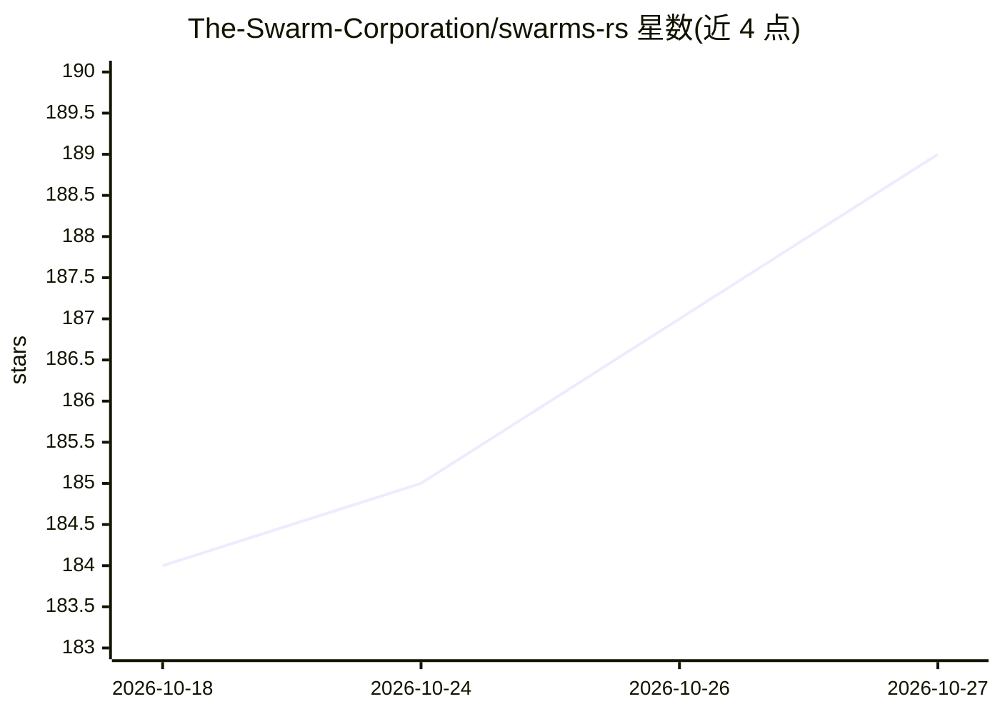

# The-Swarm-Corporation/swarms-rs

⭐ 189 · Rust · Apache-2.0 · 推送 2026-10-26 · [GitHub](https://github.com/The-Swarm-Corporation/swarms-rs) · [官网](https://docs.rs/swarms-rs/latest/swarms_rs/) · 组织维护

**Rust 编写的多 Agent 编排框架，供开发者构建 LLM Agent 系统**

用 Rust 实现的多 Agent 编排框架，以 Cargo crate 形式提供。核心构件包括带工具、记忆、规划与持久化的 Agent；LLM 提供方抽象（OpenAI 兼容 API、Anthropic Claude、DeepSeek、OpenRouter）；通过 AnyModel 按模型名切换提供方；支持 #[tool] 宏把 Rust 函数变为工具，并可经 STDIO/SSE 接入 MCP 服务器。编排模式含顺序/并发/图工作流、子 Agent 与交接、Swarm 路由和批量执行。运行需 Rust 环境与 LLM API key。

## 筛选速览

| 维度 | 判定 | 备注 |
|---|---|---|
| AI 角色 | `ai-ecosystem` | LLM/agent 周边工具 |
| 许可风险 | `permissive` | Apache-2.0 |
| 部署形态 | `library` | 以包/库形式分发 |
| 模型依赖 | local-ok | 支持本地模型 |
| 硬件要求 | — | 无带数字的原话,不猜 |
| 安装摩擦 | `low` | 无编译、无系统依赖或容器化 |
| 成熟度 | — | 结构信号不足 |

## 能力要点

- 顺序/并发/图工作流、子 Agent 与 handoff、Swarm 路由、批量执行等多 Agent 结构
- #[tool] 宏将 Rust 函数转为工具，支持 STDIO/SSE 两种 MCP 服务器接入
- AnyModel 按模型名自动选择提供方，OpenAI 兼容 API、Anthropic、DeepSeek、OpenRouter 均可用
- Agent 状态与对话可保存到磁盘的持久化层

## 适用场景

- 用 Rust 构建并编排多 Agent 协作工作流
- 让多个不同提供方的模型并发回答同一问题或组成多阶段流水线
- 把现有 Rust 函数封装为 LLM 工具或接入 MCP 工具服务器

## 场景标签

`多智能体` · 领域:Agent 开发

## 证据(README 行号)

> L14:  The Enterprise-Grade Production-Ready Multi-Agent Orchestration Framework in Rust
> L260: |**LLM Provider Layer**|Abstraction for different LLM providers (OpenAI, Anthropic, OpenRouter, DeepSeek, etc.)|

## 星数曲线

2026-10-18 184 → 2026-10-27 189（+5）

---
*卡片 v1 · prompt 1.4 · 生成 2026-10-22 · 置信度 high · 依据 README sha `defc60fb4808` · [字段定义](../../DATASET.md)*
