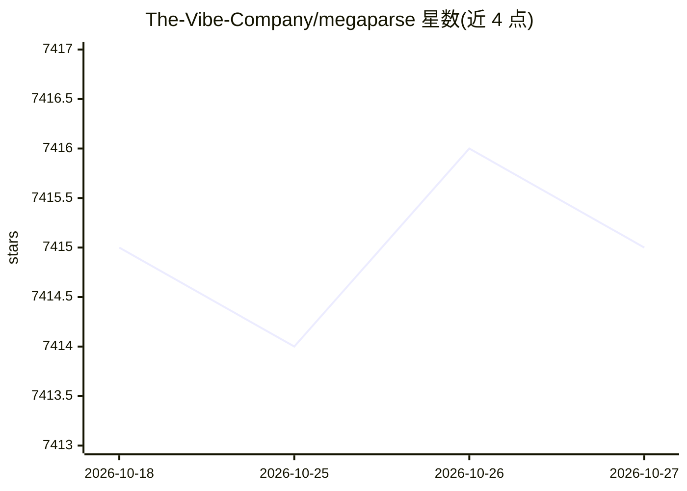

# The-Vibe-Company/megaparse

⭐ 7,415 · Python · Apache-2.0 · 推送 2026-10-15 · [GitHub](https://github.com/The-Vibe-Company/megaparse) · [官网](https://megaparse.com) · 组织维护

**面向 LLM 摄取的文档解析器：无损转换 PDF/Office 文件**

解析文本、PDF、PowerPoint、Word、Excel、CSV 等多种格式文档，输出适合 LLM 使用的格式，目标是在解析过程中不丢失信息。供需要将文档喂给 LLM 的开发者使用。提供两种模式：常规解析（megaparse.load）与 MegaParse Vision（调用 GPT-4o/Claude 等多模态模型做视觉解析，需配置 OpenAI 或 Anthropic API key）。以 pip 包分发，需 Python≥3.11，PDF/图片场景需额外安装 poppler 与 tesseract，macOS 还需 libmagic；另附 Makefile 可作为本地 API 服务运行。

## 筛选速览

| 维度 | 判定 | 备注 |
|---|---|---|
| AI 角色 | `ai-ecosystem` | LLM/agent 周边工具 |
| 许可风险 | `permissive` | Apache-2.0 |
| 部署形态 | `library` | 以包/库形式分发 |
| 模型依赖 | — | README 未给出锁定关系 |
| 硬件要求 | — | 无带数字的原话,不猜 |
| 安装摩擦 | `low` | 无编译、无系统依赖或容器化 |
| 成熟度 | — | 结构信号不足 |

## 能力要点

- 支持 Text/PDF/PPTx/Word/Excel/CSV 多格式解析
- 以无信息丢失为设计目标
- MegaParse Vision 模式调用多模态模型（gpt-4o、claude 3.5/4 等）
- 提供 Makefile 一键启动 API 服务（localhost:8000/docs）

## 适用场景

- 把 PDF/Office 文档转换后送入 LLM 或 RAG 流水线
- 需要保留文档完整信息的高保真解析
- 以 API 服务形式在本地部署文档解析能力

## 场景标签

`文档解析` · 领域:知识与检索

## 证据(README 行号)

> L5: MegaParse is a powerful and versatile parser that can handle various types of documents with ease. Whether you're de
> L31: 1. Add your OpenAI or Anthropic API key to the .env file

## 星数曲线

2026-10-18 7,415 → 2026-10-27 7,415（+0）

---
*卡片 v1 · prompt 1.4 · 生成 2026-10-20 · 置信度 high · 依据 README sha `4761d2ef12ff` · [字段定义](../../DATASET.md)*
