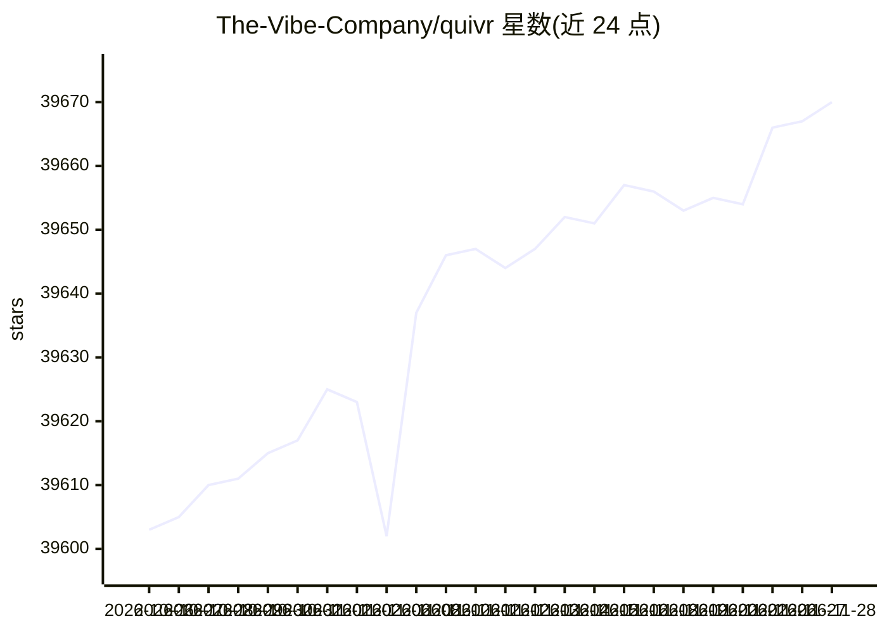

# The-Vibe-Company/quivr

⭐ 39,670 · Go · MIT · 推送 2026-11-27 · [GitHub](https://github.com/The-Vibe-Company/quivr) · [官网](https://www.thevibecompany.co/en/portfolio/quivr) · 组织维护

**为开发者把持续内容流转成可搜索可告警的引擎**

以 HTTP API 交付的开源内容引擎，无自带界面：接收文档（PDF、新闻、邮件、帖子），可从 RSS、Microsoft 365 邮箱与 X 列表定时拉取；保留每个版本，数秒内可检索，并按保存的告警规则匹配新文档、以签名 webhook 推送。检索支持关键词、语义或混合方式，结果指向具体段落与版本，最多联合检索 16 个语料库。格式、嵌入模型、排序与告警规则均为可替换的 HTTP 插件，存储基于 PostgreSQL 17，需 Linux x86_64 或 Apple Silicon Mac 自托管。

## 筛选速览

| 维度 | 判定 | 备注 |
|---|---|---|
| AI 角色 | `ai-ecosystem` | LLM/agent 周边工具 |
| 许可风险 | `permissive` | MIT |
| 部署形态 | `None` |  |
| 模型依赖 | — | README 未给出锁定关系 |
| 硬件要求 | — | 无带数字的原话,不猜 |
| 安装摩擦 | `low` | 无编译、无系统依赖或容器化 |
| 成熟度 | — | 结构信号不足 |

## 动量与使用信号

- 维护:`active` — 距上次 push 2.8 天,年发版 7,117 位贡献者
- 涨星:近 1 天 **+9**(自 20261016 起算)
- 平台:MACOS / LINUX · 协议:OPENAI-API / MCP

## 能力要点

- 持久化摄取：确认入库后异步处理，故障不丢已确认文档，索引可重建
- 混合检索并溯源到精确段落/文档/版本，最多 16 语料库联合检索
- 告警规则（布尔语法或自然语言描述）以签名 webhook 通知匹配
- 格式/来源/嵌入模型/排序/告警规则均为任意语言实现的插件

## 适用场景

- 为自己的应用接入持续到达的文档流并提供带出处的搜索
- 监控主题词：新文档命中告警时自动通知
- 对修订与撤稿有版本与可见性要求的文档管理
- 让 AI Agent 通过 quivr mcp 检索并引用来源

## 场景标签

`语义搜索` · 领域:知识与检索

## 证据(README 行号)

> L12: application talks to Quivr over an HTTP API; Quivr has no user interface of its own.
> L34: - **Plug in your own logic.** File formats, sources, embedding models, ranking and alert
> L40: - **Let AI agents use it.** `quivr mcp` lets an agent search Quivr and quote what it

## 星数曲线

2026-10-26 39,603 → 2026-11-28 39,670（+67）

---
*卡片 v1 · prompt 1.4 · 生成 2026-11-27 · 置信度 high · 依据 README sha `63a45e494c7b` · [字段定义](../../DATASET.md)*
