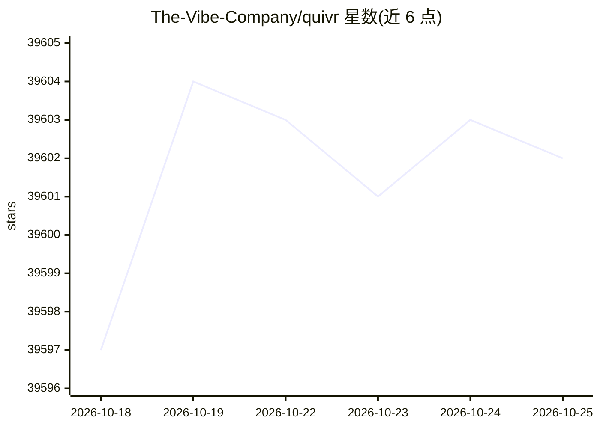

# The-Vibe-Company/quivr

⭐ 39,603 · Go · MIT · 推送 2026-10-21 · [GitHub](https://github.com/The-Vibe-Company/quivr) · [官网](https://docs.quivr.thevibecompany.co) · 组织维护

**开源内容流搜索引擎：将持续内容转为可搜索与监控**

以 Go 编写的单二进制引擎（api/worker/migrate 命令），将持续输入的内容流持久化摄入并提供词汇、语义与混合检索，支持保存的查询、订阅与告警（关键词、描述式、本地语义三类），告警通过签名 webhook 投递。核心保持通用，连接器、规范化、增强、检索与投递均为插件能力。数据规范存储于 PostgreSQL 与 S3，搜索索引为可重建投影。当前处于评估阶段，API 为 v0，README 明确不建议用于生产。

## 筛选速览

| 维度 | 判定 | 备注 |
|---|---|---|
| AI 角色 | `ai-enhanced` | 去掉 AI 部分产品仍成立 |
| 许可风险 | `permissive` | MIT |
| 部署形态 | `self-host` | docker 或自建部署 |
| 模型依赖 | — | README 未给出锁定关系 |
| 硬件要求 | — | 无带数字的原话,不猜 |
| 安装摩擦 | `low` | 无编译、无系统依赖或容器化 |
| 成熟度 | `idea` | |

## 动量与使用信号

- 维护:`active` — 距上次 push 2.8 天,年发版 7,117 位贡献者
- 涨星:近 1 天 **+9**(自 20261016 起算)
- 平台:MACOS / LINUX · 协议:OPENAI-API / MCP

## 能力要点

- 持久化与幂等摄入：写入提交确认、幂等键、不可变版本与更正/撤回机制
- 词汇、语义与混合检索，每次命中从规范存储回读并重新鉴权
- 三类告警插件：布尔关键词、外部分类器描述式、基于本地向量的语义告警
- 索引可从持久化工件重建，签名 webhook 投递与重试

## 适用场景

- 持续跟踪新闻流并按关键词或语义条件触发告警
- 为多来源文档构建带权限校验的混合检索服务
- 需要更正、撤回与版本历史的合规性内容库

## 场景标签

`语义搜索` `网页抓取` · 领域:效率与自动化

## 证据(README 行号)

> L5: **An open-source engine that turns continuous content streams into search and monitoring.**
> L49: |Lexical and vector search|Weaviate|
> L50: |Embeddings|Local TEI serving pinned `multilingual-e5-small` (384 dimensions)|

## 星数曲线

2026-10-18 39,597 → 2026-10-25 39,602（+5）

---
*卡片 v1 · prompt 1.4 · 生成 2026-10-18 · 置信度 high · 依据 README sha `b4017d418e12` · [字段定义](../../DATASET.md)*
