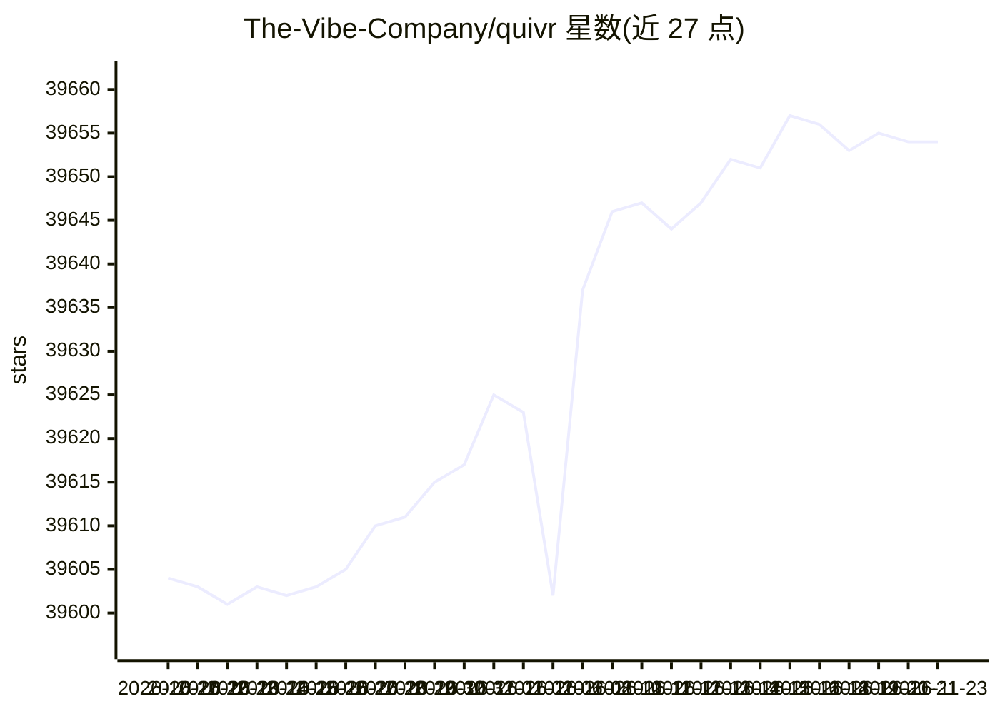

# The-Vibe-Company/quivr

⭐ 39,654 · Go · MIT · 推送 2026-11-16 · [GitHub](https://github.com/The-Vibe-Company/quivr) · [官网](https://www.thevibecompany.co/en/portfolio/quivr) · 组织维护

**持续内容流的搜索与监控引擎：存储、检索、告警**

Quivr 是 The Vibe Company 开发的开源引擎（Go 实现，MIT 许可），将持续到达的内容（文档、RSS、Microsoft 365 邮箱、X 列表）存入 PostgreSQL 与对象存储，秒级可检索，并按保存的告警规则匹配新文档。检索结果指向精确段落、文档与版本以便引用；文档版本化保留历史，撤回文档即退出搜索。格式解析、嵌入模型、排序与告警规则均为可替换的插件（任意语言的小型 HTTP 服务），并通过 `quivr mcp` 供 AI agent 检索引用。产品本身为 HTTP API，无自带界面。

## 筛选速览

| 维度 | 判定 | 备注 |
|---|---|---|
| AI 角色 | `ai-ecosystem` | LLM/agent 周边工具 |
| 许可风险 | `permissive` | MIT |
| 部署形态 | `None` |  |
| 模型依赖 | — | README 未给出锁定关系 |
| 硬件要求 | — | 无带数字的原话,不猜 |
| 安装摩擦 | `low` | 无编译、无系统依赖或容器化 |
| 成熟度 | — | 结构信号不足 |

## 动量与使用信号

- 维护:`active` — 距上次 push 2.8 天,年发版 7,117 位贡献者
- 涨星:近 1 天 **+9**(自 20261016 起算)
- 平台:MACOS / LINUX · 协议:OPENAI-API / MCP

## 能力要点

- 混合检索：关键词、语义或两者结合，结果可溯源到具体段落与版本
- 主题告警：布尔表达式或自然语言描述，匹配结果经签名 webhook 推送
- 格式/来源/嵌入模型/排序/告警规则均为可插拔 HTTP 服务
- 内置 `quivr mcp`，AI agent 可检索并带出处引用

## 适用场景

- 监控新闻、邮件、社媒中与关注主题相关的新内容
- 为应用构建可引用出处的文档搜索后端
- 对 PDF 等文档做版本化存储与历史追溯
- 让 AI agent 通过 MCP 检索企业内容流

## 场景标签

`RAG` `语义搜索` · 领域:知识与检索

## 证据(README 行号)

> L12: application talks to Quivr over an HTTP API; Quivr has no user interface of its own.
> L35: - **Let AI agents use it.** `quivr mcp` lets an agent search Quivr and quote what it

## 星数曲线

2026-10-21 39,604 → 2026-11-23 39,654（+50）

---
*卡片 v1 · prompt 1.4 · 生成 2026-11-22 · 置信度 high · 依据 README sha `8adf3dcc426d` · [字段定义](../../DATASET.md)*
