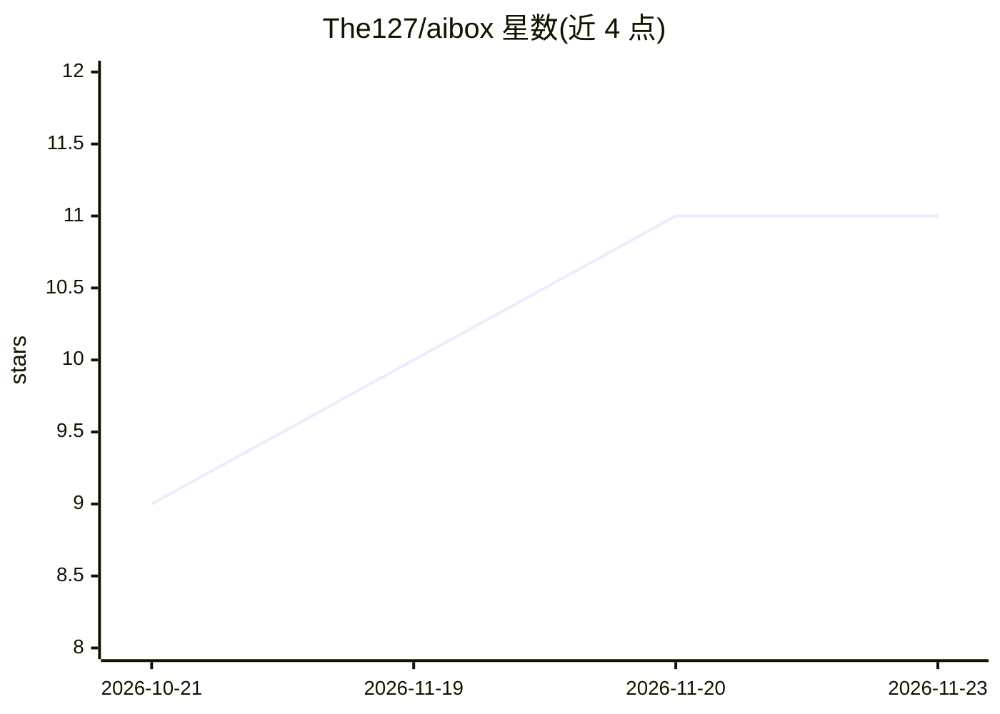

# The127/aibox

⭐ 11 · Go · Apache-2.0 · 推送 2026-11-22 · [GitHub](https://github.com/The127/aibox) · [官网](https://the127.github.io/aibox/) · 组织维护

**在安全微虚拟机中运行 Claude Code 的沙箱工具**

aibox 把 Claude Code 放进一个小型虚拟机里运行：VM 有独立内核、无网卡，仅能通过宿主机上的代理访问白名单主机，只能看到用户共享的项目文件夹，约一秒启动。SSH 密钥、云登录、git 凭据留在宿主机；API key 不进入 VM，由代理在请求途中注入。提供 `aibox run`（交互式）、`clone` 模式与 `aibox task`（自主执行任务并以分支返回提交）。支持 podman 容器、mise 工具安装与 VS Code/GoLand 连接。

## 筛选速览

| 维度 | 判定 | 备注 |
|---|---|---|
| AI 角色 | `ai-ecosystem` | LLM/agent 周边工具 |
| 许可风险 | `permissive` | Apache-2.0 |
| 部署形态 | `desktop` | 安装包/桌面程序 |
| 模型依赖 | locked-api |  |
| 硬件要求 | — | 无带数字的原话,不猜 |
| 安装摩擦 | `low` | 无编译、无系统依赖或容器化 |
| 成熟度 | — | 结构信号不足 |

## 能力要点

- 独立内核微 VM，无网卡，所有网络经代理逐连接检查
- API key 不进入 VM，代理在通往 Claude API 的途中注入
- aibox task 自主执行任务，VM 用后即删，提交以分支返回
- git 推送限制在配置列出的分支，拒绝删分支/删 tag

## 适用场景

- 让 Claude Code 修改项目但不给它访问 SSH 密钥和其他项目
- 批量并行运行自主编码任务并审查返回的提交
- 限制 AI 编码代理能访问的网络主机范围

## 场景标签

`编码 Agent` · 领域:编码与开发

## 证据(README 行号)

> L13: aibox runs Claude Code in a small virtual machine that only sees the folders
> L15: no network card. Its only way to the network is a proxy on your machine that
> L40: Your API key never enters the VM. Claude Code gets a placeholder, and aibox

## 星数曲线

2026-10-21 9 → 2026-11-23 11（+2）

---
*卡片 v1 · prompt 1.4 · 生成 2026-11-20 · 置信度 high · 依据 README sha `1e5806bec114` · [字段定义](../../DATASET.md)*
