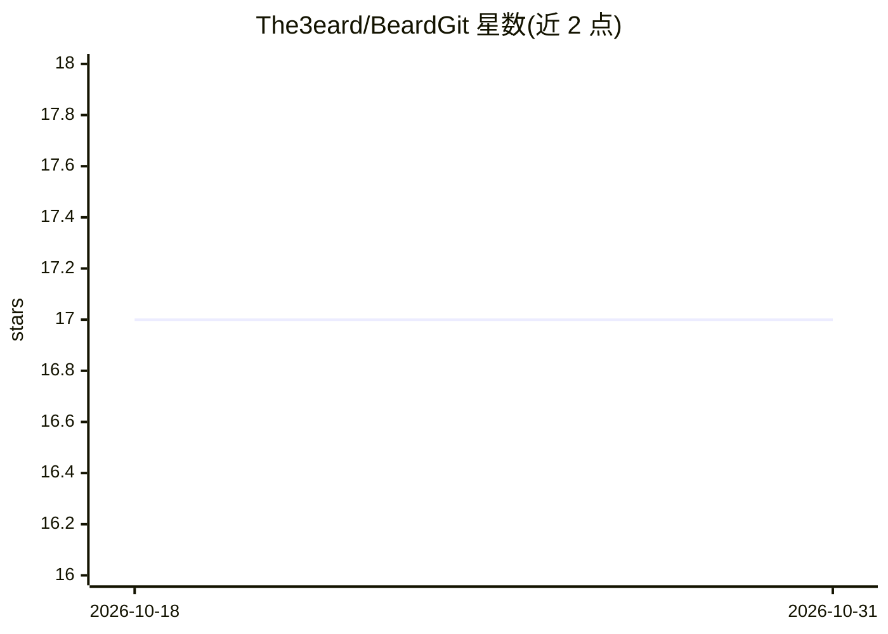

# The3eard/BeardGit

⭐ 17 · Rust · NOASSERTION · 推送 2026-09-21 · [GitHub](https://github.com/The3eard/BeardGit) · [官网](https://the3eard.github.io/BeardGit/) · 个人维护

**把提交图、PR/MR、CI、终端、AI 与编辑器装进一个窗口的桌面 Git 客户端**

基于 Tauri 的原生桌面 Git 客户端，覆盖提交图、行级暂存、GitHub/GitLab 的 PR/MR 与流水线、分支树、worktree、终端、.http 请求文件与 CodeMirror 编辑器。AI 部分：调用用户自装的 Claude Code、Codex 或 OpenCode，在隔离 worktree 的 ai/<provider>/<slug> 分支上排队运行，可读 transcript 后合并或丢弃，且提供开关整体关闭 AI 集成。单人开发，构建未签名，仅支持 GitHub/GitLab 两家 forge，需 git 在 PATH 上。macOS/Linux/Windows 提供安装包。

## 筛选速览

| 维度 | 判定 | 备注 |
|---|---|---|
| AI 角色 | `ai-enhanced` | 去掉 AI 部分产品仍成立 |
| 许可风险 | `none` | NOASSERTION |
| 部署形态 | `desktop` | 安装包/桌面程序 |
| 模型依赖 | — | README 未给出锁定关系 |
| 硬件要求 | — | 无带数字的原话,不猜 |
| 安装摩擦 | `low` | 无编译、无系统依赖或容器化 |
| 成熟度 | `idea` | |

## 能力要点

- 集成自装的 Claude Code/Codex/OpenCode，在隔离 worktree 分支上排队运行，主 checkout 不动
- GitHub 与 GitLab 双 forge 支持，含自托管实例，按 host 校验认证
- 行级暂存与提交签名（SSH/GPG/X.509）遵循 git 配置
- 内置终端（Rust PTY）、.http 请求工作区与 31 套主题

## 适用场景

- 在一个窗口内完成提交、审查 PR、看流水线与发布
- 把 AI CLI 跑在隔离 worktree 里，读 transcript 后决定合并或丢弃
- 在仓库上下文中直接测试 .http 接口请求

## 场景标签

 · 领域:开发者工具/Git 客户端

## 证据(README 行号)

> L41: - **AI that runs in a worktree.** Your own install of Claude Code, Codex or OpenCode, started on an `ai/<provider>/
> L47: - **Multi-repo tabs that stay cheap.** Heavy state loads only for the active tab, and every section remembers its f

## 星数曲线

2026-10-18 17 → 2026-10-31 17（+0）

---
*卡片 v1 · prompt 1.4 · 生成 2026-10-29 · 置信度 mid · 依据 README sha `a94c71396f43` · [字段定义](../../DATASET.md)*
