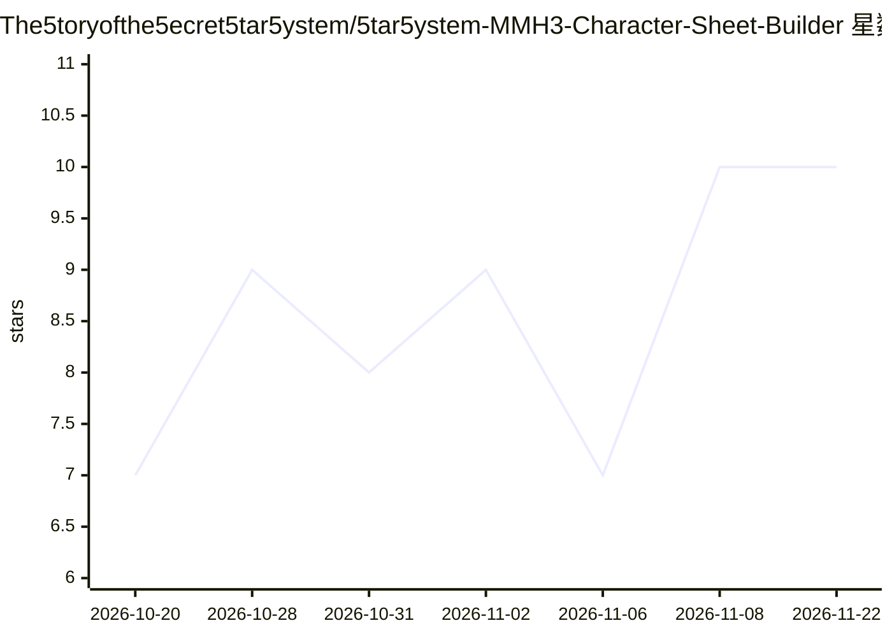

# The5toryofthe5ecret5tar5ystem/5tar5ystem-MMH3-Character-Sheet-Builder

⭐ 10 · Python · GPL-3.0 · 推送 2026-10-14 · [GitHub](https://github.com/The5toryofthe5ecret5tar5ystem/5tar5ystem-MMH3-Character-Sheet-Builder) · 个人维护

**给 ComfyUI 用户的 MiniMax H3 角色设定图生成节点包**

以独立 ComfyUI 自定义节点包形式发布的 MiniMax H3 角色设定图构建工具：接收最多 9 张图片、3 段视频与 3 段音频作为带角色说明的参考素材，按 15 种视角、13 种姿势、20 种表情勾选生成单元格矩阵，渲染由 ComfyUI 核心 H3 节点完成，本包提供参考角色管理、人脸模糊、单元格间 latent 续接、逐帧挑选与合成拼版，并可导出为 RefMod 参考适配器。需自备四个模型文件加可选人脸检测器，无需其他节点包。

## 筛选速览

| 维度 | 判定 | 备注 |
|---|---|---|
| AI 角色 | `ai-native` | 本体是模型或模型工具 |
| 许可风险 | `viral` | GPL-3.0 |
| 部署形态 | `None` |  |
| 模型依赖 | — | README 未给出锁定关系 |
| 硬件要求 | — | 无带数字的原话,不猜 |
| 安装摩擦 | `medium` | 含编译或系统依赖之一 |
| 成熟度 | — | 结构信号不足 |

## 能力要点

- 带角色的参考素材管理（图片/视频/音频各设用途说明）
- 15 视角×13 姿势×20 表情的单元格矩阵与逐格重掷种子
- 非身份参考的人脸模糊（含视频中逐帧跟踪与音频静音替代）
- 合成设定图导出为含外观与声音的 RefMod，无需训练

## 适用场景

- 为 ref2va 工作流批量生成角色多视角参考图
- 把人物照片/视频/音频整理成一张可复用的角色设定图
- 在 ComfyUI 中管理 LoRA 栈并按 hash 查询 Civitai 元数据

## 场景标签

`图像生成` `多模态` · 领域:内容生成

## 证据(README 行号)

> L12: Standalone **MiniMax H3 character sheet builder** for ComfyUI: give it photos, videos
> L17: No other custom node pack is required. The renders are done by **ComfyUI core
> L19: -> `VAEDecode`); this pack adds the sheet: the cell matrix, the reference roles, the

## 星数曲线

2026-10-20 7 → 2026-11-22 10（+3）

---
*卡片 v1 · prompt 1.4 · 生成 2026-11-20 · 置信度 high · 依据 README sha `2f4cf8a2fd97` · [字段定义](../../DATASET.md)*
