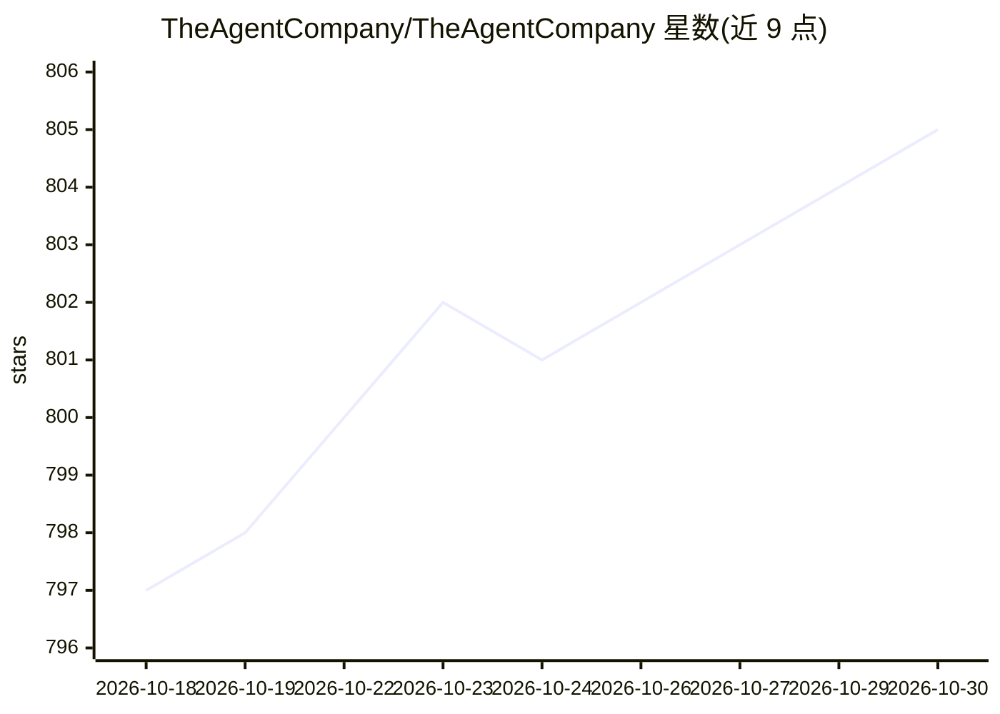

# TheAgentCompany/TheAgentCompany

⭐ 805 · Python · MIT · 推送 2025-11-17 · [GitHub](https://github.com/TheAgentCompany/TheAgentCompany) · [官网](https://the-agent-company.com) · 组织维护

**评测 LLM agent 执行真实职场任务的基准（175 项任务）**

在模拟软件公司环境中评测 LLM agent 的可扩展基准：通过 Docker 部署 GitLab、Plane、ownCloud、RocketChat 等带预置数据的服务，提供 175 个任务镜像，覆盖软件工程师、产品经理、数据科学家等角色与编程、对话、数学推理、图像处理等数据类型，agent 通过浏览网页、写代码、运行程序、与同事交流完成任务。评分采用结果评估为主、子检查点为辅，支持确定性评估器与 LLM 评估器，另支持多 agent 交互。原生适配 OpenHands 平台，也可手动运行其他 agent。运行需 Docker 与 30GB 以上磁盘空间。

## 筛选速览

| 维度 | 判定 | 备注 |
|---|---|---|
| AI 角色 | `ai-ecosystem` | LLM/agent 周边工具 |
| 许可风险 | `permissive` | MIT |
| 部署形态 | `self-host` | docker 或自建部署 |
| 模型依赖 | — | README 未给出锁定关系 |
| 硬件要求 | — | 无带数字的原话,不猜 |
| 安装摩擦 | `low` | 无编译、无系统依赖或容器化 |
| 成熟度 | — | 结构信号不足 |

## 能力要点

- 175 个任务镜像，模拟含 GitLab/Plane/ownCloud/RocketChat 的软件公司环境
- 评分体系：结果评估为主、子检查点为辅，含确定性与 LLM 两类评估器
- 覆盖 6 种职场角色与 5 类数据类型的任务，支持多 agent 交互
- 框架可扩展，可在数分钟内添加新任务/评估器/子检查点

## 适用场景

- 评测自研或第三方 LLM agent 处理职场任务的能力
- 对比不同 agent 框架在真实工作场景中的表现
- 扩展自定义任务与评估器构建领域评测

## 场景标签

`模型评测` · 领域:评测与运维

## 证据(README 行号)

> L18: TheAgentCompany measures the progress of these LLM agents' performance on performing real-world professional tasks,
> L19: by providing an extensible benchmark for evaluating AI agents that interact with the world in similar ways to those
> L99: A complete list of 175 task images can be found here.

## 星数曲线

2026-10-18 797 → 2026-10-30 805（+8）

---
*卡片 v1 · prompt 1.4 · 生成 2026-10-21 · 置信度 high · 依据 README sha `d687e4f72b78` · [字段定义](../../DATASET.md)*
