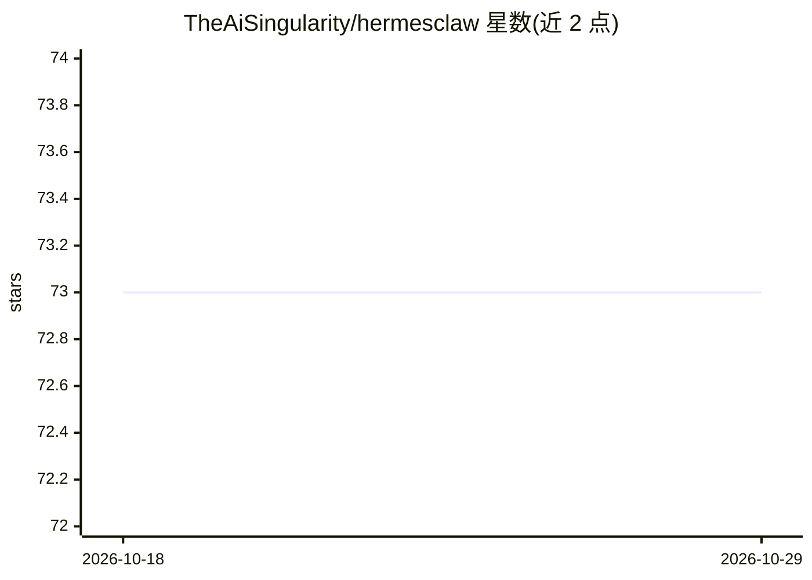

# TheAiSingularity/hermesclaw

⭐ 73 · Shell · MIT · 推送 2026-04-24 · [GitHub](https://github.com/TheAiSingularity/hermesclaw) · 个人维护

**将 Hermes Agent 运行于 NVIDIA OpenShell 硬件级沙箱的社区实现**

把 NousResearch 的 Hermes Agent 装入 NVIDIA OpenShell 沙箱（可选）并以 Docker 容器运行的社区实现：通过 OPA 代理、Landlock LSM、Seccomp BPF 与隐私路由在内核层限制网络出口、文件写入与危险系统调用，提供 strict/gateway/permissive 三档可热切换的策略预设。保留 Hermes 的持久记忆（MEMORY.md/USER.md）、DSPy+GEPA 自改进技能、40+ 工具、Telegram/Discord 等消息网关与 MCP/IDE 集成；本地推理经 llama.cpp 的 llama-server 运行，也可切换 NVIDIA NIM、OpenAI、Anthropic、Ollama、vLLM 后端。提供一键安装脚本与 hermesclaw CLI。

## 筛选速览

| 维度 | 判定 | 备注 |
|---|---|---|
| AI 角色 | `ai-ecosystem` | LLM/agent 周边工具 |
| 许可风险 | `permissive` | MIT |
| 部署形态 | `self-host` | docker 或自建部署 |
| 模型依赖 | local-ok | 支持本地模型 |
| 硬件要求 | — | 无带数字的原话,不猜 |
| 安装摩擦 | `low` | 无编译、无系统依赖或容器化 |
| 成熟度 | — | 结构信号不足 |

## 能力要点

- OpenShell 四层（网络/文件/进程/推理）进程外强制隔离
- 三档策略预设无需重启沙箱即可切换
- 保留 Hermes 持久记忆与 DSPy+GEPA 自改进技能
- 支持 llama.cpp/NIM/OpenAI/Anthropic/Ollama/vLLM 多推理后端

## 适用场景

- 以硬件级沙箱运行 AI agent，限制其网络与文件访问
- 通过 Telegram/Discord 等消息平台长期使用个人 agent
- 隐私受监管场景下以 strict 策略部署 agent

## 场景标签

`AI 助手` · 领域:对话与助手

## 证据(README 行号)

> L10: NVIDIA built OpenShell to hardware-enforce AI agent behavior — blocking network egress, filesystem writes, and dang
> L18: OpenShell intercepts every call to `inference.local` inside the sandbox and routes it to the configured backend. He
> L160: |**Inference providers**|llama.cpp, NVIDIA NIM, OpenAI, Anthropic, Ollama, vLLM|OpenAI, Anthropic, Gemini, NVIDIA 

## 星数曲线

2026-10-18 73 → 2026-10-29 73（+0）

---
*卡片 v1 · prompt 1.4 · 生成 2026-10-24 · 置信度 high · 依据 README sha `97c7089d87b3` · [字段定义](../../DATASET.md)*
