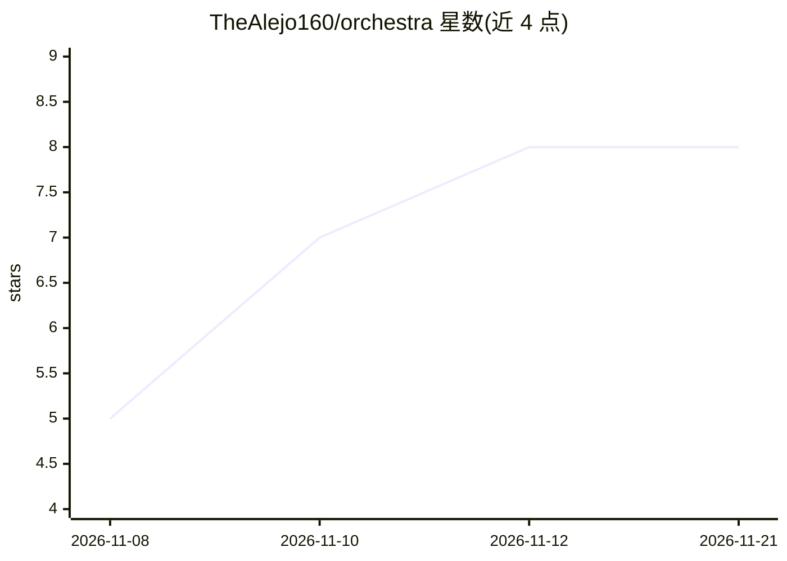

# TheAlejo160/orchestra

⭐ 8 · TypeScript · MIT · 推送 2026-11-05 · [GitHub](https://github.com/TheAlejo160/orchestra) · 个人维护

**Claude Code 插件：多 CLI agent 任务分派与协调**

orchestra 是 Claude Code 的插件（mod），按任务类型、难度、上下文需求与成本把工作分派给 Claude 子代理或本机已安装的其他 CLI agent（Codex、Antigravity/Gemini、OpenCode、Copilot、Kimi）。机制包括：每会话读取各 CLI 当前可用模型、delegate 工具后台运行外部代理、共享 board、文件编辑守卫、Haiku 摘要中继、默认开启的 lean 模式，以及实时 pane 展示用量与各代理状态。mod 仅在 Claude Code 运行；SKILL.md 技能可单独装入其他 agent。

## 筛选速览

| 维度 | 判定 | 备注 |
|---|---|---|
| AI 角色 | `ai-ecosystem` | LLM/agent 周边工具 |
| 许可风险 | `permissive` | MIT |
| 部署形态 | `None` |  |
| 模型依赖 | locked-api |  |
| 硬件要求 | — | 无带数字的原话,不猜 |
| 安装摩擦 | `low` | 无编译、无系统依赖或容器化 |
| 成熟度 | — | 结构信号不足 |

## 能力要点

- 按工作量/难度/成本动态选模型，免费模型优先、Claude 限额最后
- delegate 工具后台运行外部 CLI agent 并实时跟踪、生成报告
- board 消息板 + 文件守卫 + 编辑记录实现多 agent 协调
- Haiku 中继压缩长报告，保留路径与标识符原文兜底

## 适用场景

- 在 Claude Code 里把子任务分派给多个已登录的 CLI agent
- 按配额成本规划各 agent 的使用顺序
- 给 Codex/Copilot/Gemini 等安装效率技能文件

## 场景标签

`多智能体` `编码 Agent` · 领域:Agent 开发

## 证据(README 行号)

> L9: orchestra is a mod (plugin) for Claude Code. It hands each part of a task to the cheapest model that does that part 
> L93: **The mod runs only in Claude Code,** because it is built on Claude Code's plugin API: the pane, the hooks and the 
> L54: - **A recent Claude Code with mod support** (plugin hooks modules). Tested on 2.1.318.

## 星数曲线

2026-11-08 5 → 2026-11-21 8（+3）

---
*卡片 v1 · prompt 1.4 · 生成 2026-11-20 · 置信度 high · 依据 README sha `20ab2296d0ed` · [字段定义](../../DATASET.md)*
