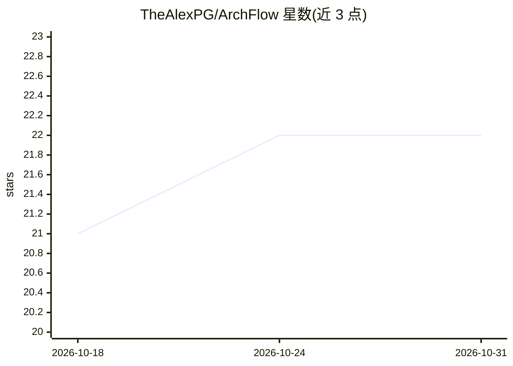

# TheAlexPG/ArchFlow

⭐ 22 · Python · AGPL-3.0 · 推送 2026-05-18 · [GitHub](https://github.com/TheAlexPG/ArchFlow) · [官网](https://archflow.tools) · 个人维护

**自托管的 C4 架构图协作平台，架构模型像代码一样分支评审**

面向团队的开源自托管 C4 架构建模平台，自称 IcePanel 的开源替代。以类型化数据模型（system/container/component/actor 等）管理架构，支持 L1→L3 逐层下钻、实时协作（光标/在线状态/乐观更新）、图表 Fork 为草稿并 diff 合并、版本快照回滚、团队级图表 ACL、约 170 种内置技术目录。AI 部分为可选功能：基于 LangGraph 的多 agent 主管（规划/研究/画图/评审）、GitHub 仓库研究子 agent、图表自然语言解释，通过 LiteLLM 接入 OpenAI/Anthropic/OpenRouter 等，需配置 AGENTS_SECRET_KEY 加密密钥。技术栈 FastAPI+PostgreSQL+React，提供 Docker Compose 与 Helm 部署，AGPL-3.0 许可。

## 筛选速览

| 维度 | 判定 | 备注 |
|---|---|---|
| AI 角色 | `ai-enhanced` | 去掉 AI 部分产品仍成立 |
| 许可风险 | `viral` | AGPL-3.0 |
| 部署形态 | `self-host` | docker 或自建部署 |
| 模型依赖 | — | README 未给出锁定关系 |
| 硬件要求 | — | 无带数字的原话,不猜 |
| 安装摩擦 | `low` | 无编译、无系统依赖或容器化 |
| 成熟度 | — | 结构信号不足 |

## 能力要点

- 架构为类型化数据模型：对象有类型/生命周期/关系/版本历史，L1-L3 各画布独立坐标
- 草稿 Fork、diff 对比、冲突解决与合并；版本快照可回滚
- 多 agent 主管（LangGraph）+ GitHub 仓库研究子 agent + 图表自然语言解释，经 LiteLLM 接入多家 LLM
- 导出 Mermaid/PlantUML/Structurizr DSL/JSON，支持 OIDC SSO、API key 与 Webhook

## 适用场景

- 团队以分支-评审流程协同维护软件架构图
- 用自然语言让 agent 生成或解释架构图
- 把架构对象关联 GitHub 仓库，基于真实代码回答设计问题
- 自托管部署企业级架构知识库并按团队控制访问权限

## 场景标签

 · 领域:软件开发/架构工具

## 证据(README 行号)

> L18: **ArchFlow is an open-source alternative to IcePanel** — a collaborative, real-time workspace for modeling software
> L67: ### 🤖 AI agents
> L213: **Without it:**

## 星数曲线

2026-10-18 21 → 2026-10-31 22（+1）

---
*卡片 v1 · prompt 1.4 · 生成 2026-10-27 · 置信度 mid · 依据 README sha `6a1132831ac5` · [字段定义](../../DATASET.md)*
