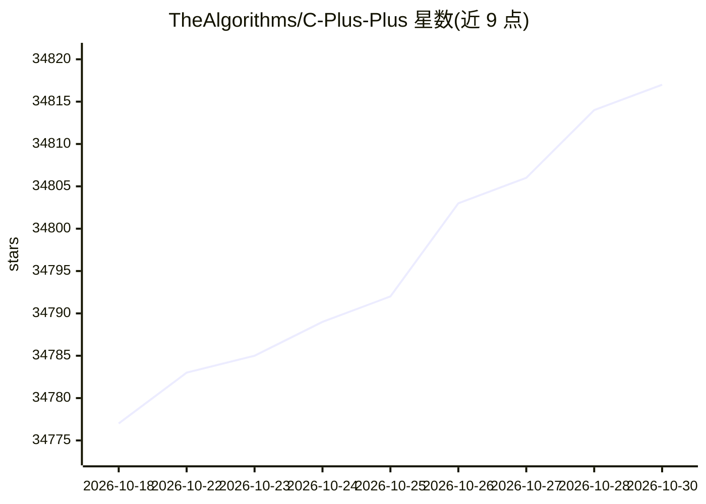

# TheAlgorithms/C-Plus-Plus

⭐ 34,817 · C++ · MIT · 推送 2026-10-03 · [GitHub](https://github.com/TheAlgorithms/C-Plus-Plus) · [官网](https://thealgorithms.github.io/C-Plus-Plus)

**面向教学的多领域 C++ 算法实现集合**

The Algorithms 社区维护的 C++ 算法实现集合，覆盖计算机科学、数学与统计、数据科学、机器学习、工程等主题，MIT 许可证开源。每个源码文件独立、仅使用 STL、无需外部库，遵循 C++17 标准，每次提交在 Windows/macOS/Ubuntu 三系统上用 MSVC/AppleClang/GNU 编译测试。文档由源码自动生成，提供程序执行说明、流程图示与 STL 函数链接。定位为教育者与学生的学习资源，同一目标可能提供多种算法策略的实现。

## 筛选速览

| 维度 | 判定 | 备注 |
|---|---|---|
| AI 角色 | `ai-knowledge` | 知识聚合/清单类 |
| 许可风险 | `permissive` | MIT |
| 部署形态 | `None` |  |
| 模型依赖 | — | README 未给出锁定关系 |
| 硬件要求 | — | 无带数字的原话,不猜 |
| 安装摩擦 | `low` | 无编译、无系统依赖或容器化 |
| 成熟度 | — | 结构信号不足 |

## 动量与使用信号

- 维护:`active` — 距上次 push 14.9 天,年发版 0,322 位贡献者
- 涨星:近 1 天 **+2**(自 20261016 起算)
- 平台:WINDOWS / MACOS / LINUX · 协议:—

## 能力要点

- 仅依赖 STL、无需外部库即可编译运行的原子化实现
- 每次提交在三大操作系统上以三种编译器编译测试
- 文档由源码生成，含执行说明与程序流程图
- 遵循 C++17 标准，可移植到 ESP32、ARM Cortex 等嵌入式平台

## 适用场景

- 学习算法原理并阅读带注释的 C++ 实现
- 教师在课程中作为教学素材与参考实现
- 面试准备时练习算法与数据结构

## 场景标签

`教程课程` · 领域:学习与行业

## 证据(README 行号)

> L15: This repository is a collection of open-source implementation of a variety of algorithms implemented in C++ and lic
> L21: - Each source code is atomic using STL classes and _no external libraries_ are required for their compilation and e
> L22: - Source codes are compiled and tested for every commit on the latest versions of three major operating systems viz

## 星数曲线

2026-10-18 34,777 → 2026-10-30 34,817（+40）

---
*卡片 v1 · prompt 1.4 · 生成 2026-10-18 · 置信度 high · 依据 README sha `88b1a775df83` · [字段定义](../../DATASET.md)*
