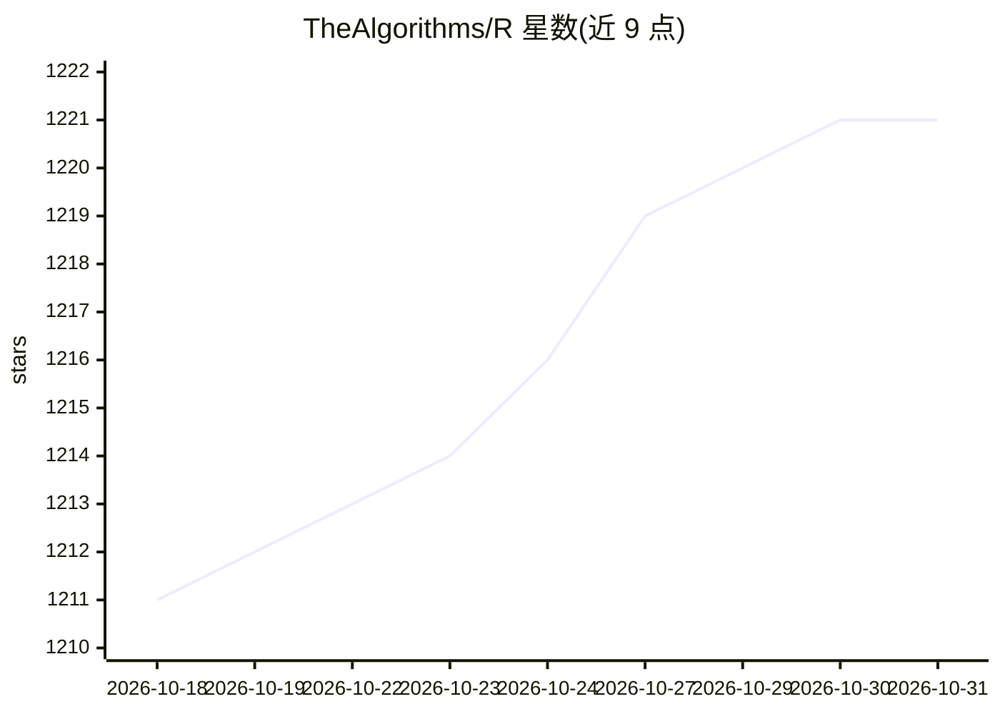

# TheAlgorithms/R

⭐ 1,221 · R · MIT · 推送 2026-06-12 · [GitHub](https://github.com/TheAlgorithms/R) · 组织维护

**R 语言算法实现合集，面向学习与教学**

TheAlgorithms 组织维护的 R 语言算法集合仓库，包含机器学习、聚类、分类、数据挖掘、数据预处理等各类算法的 R 实现，全部条目通过 DIRECTORY.md 按目录组织索引。面向学习与实践 R 的开发者和学生，README 主要内容为贡献指南：要求代码可在 R 环境运行、附带注释说明与示例、遵循命名约定并附测试验证。仓库支持 Gitpod 在线开发环境，不提供安装包或打包发布形式。

## 筛选速览

| 维度 | 判定 | 备注 |
|---|---|---|
| AI 角色 | `ai-knowledge` | 知识聚合/清单类 |
| 许可风险 | `permissive` | MIT |
| 部署形态 | `None` |  |
| 模型依赖 | — | README 未给出锁定关系 |
| 硬件要求 | — | 无带数字的原话,不猜 |
| 安装摩擦 | `low` | 无编译、无系统依赖或容器化 |
| 成熟度 | — | 结构信号不足 |

## 能力要点

- R 语言实现的算法集合，含机器学习/聚类/数据挖掘等类别
- DIRECTORY.md 按目录索引全部算法
- 提供 Gitpod Ready-to-Code 在线开发入口
- 详细的贡献指南（代码质量、命名、文档与测试要求）

## 适用场景

- 学习各类算法的 R 语言实现
- 查找聚类、分类、预处理等算法参考代码
- 通过贡献算法参与开源实践（hacktoberfest）

## 场景标签

`教程课程` · 领域:学习与行业

## 证据(README 行号)

> L1: # The Algorithms - R
> L13: All algorithms can be found in the `DIRECTORY.md` file ordered by folder.

## 星数曲线

2026-10-18 1,211 → 2026-10-31 1,221（+10）

---
*卡片 v1 · prompt 1.4 · 生成 2026-10-21 · 置信度 mid · 依据 README sha `ac85825d040c` · [字段定义](../../DATASET.md)*
