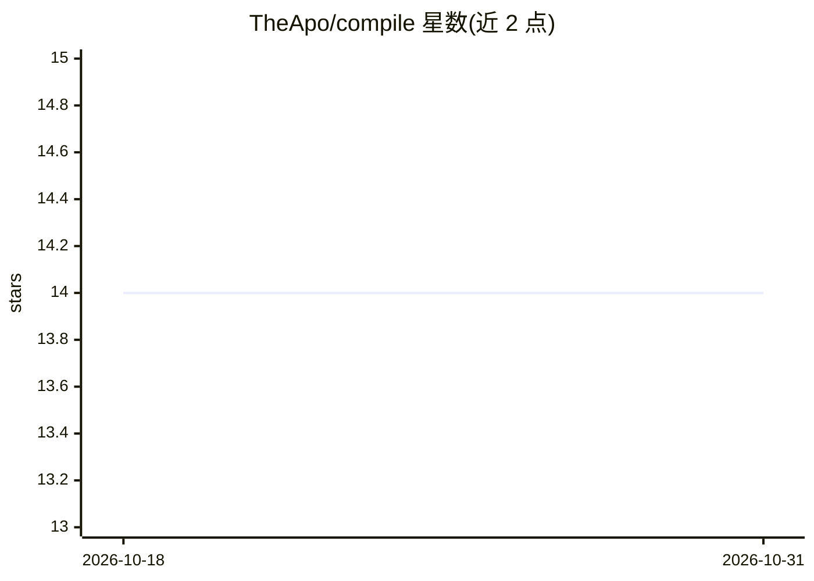

# TheApo/compile

⭐ 14 · TypeScript · 推送 2026-06-11 · [GitHub](https://github.com/TheApo/compile) · [官网](https://theapo.github.io/compile/) · 个人维护

**赛博朋克卡牌游戏 Compile 的浏览器单人 AI 对战版**

将实体卡牌游戏 Compile: Main 1 & 2（Michael Yang 设计）数字化为浏览器端单人游戏：完整收录 Main 1 的 84 张卡、Main 2 及两个扩展协议，提供 Easy/Normal 两档 AI 对手（Hard 开发中）。卡牌具备上/中/下三段能力，含可视化协议编辑器（20+ 效果类型）、逐卡动画、层级式游戏日志、规则与卡牌图鉴。100% 客户端运行，无服务器无遥测，统计与自定义协议存于 localStorage；React 19 + Vite 6 + TypeScript 构建，git clone 源码本地运行。

## 筛选速览

| 维度 | 判定 | 备注 |
|---|---|---|
| AI 角色 | `ai-enhanced` | 去掉 AI 部分产品仍成立 |
| 许可风险 | `none` | — |
| 部署形态 | `None` |  |
| 模型依赖 | — | README 未给出锁定关系 |
| 硬件要求 | — | 无带数字的原话,不猜 |
| 安装摩擦 | `low` | 无编译、无系统依赖或容器化 |
| 成熟度 | `idea` | |

## 能力要点

- 完整实现 Compile: Main 1（84 卡）与 Main 2 及两个扩展协议
- Easy/Normal 两档 AI 对手，Hard 难度开发中
- 可视化自定义协议编辑器（20+ 效果类型，可保存导出）
- 100% 客户端运行，含 Vitest 单测与 Playwright E2E 测试

## 适用场景

- 单人体验 Compile 卡牌对战，无需第二玩家与实体卡
- 用可视化编辑器创建自定义协议并投入对局
- 通过层级日志与规则/图鉴学习原版卡牌机制

## 场景标签

 · 领域:游戏/桌面娱乐

## 证据(README 行号)

> L5: A digital adaptation of the cyberpunk card game **Compile: Main 1** (+ **Main 2**, designed by Michael Yang) — reima
> L22: - **Easy** — friendly, forgiving, great for learning the ropes

## 星数曲线

2026-10-18 14 → 2026-10-31 14（+0）

---
*卡片 v1 · prompt 1.4 · 生成 2026-10-31 · 置信度 high · 依据 README sha `a4c4f38856f6` · [字段定义](../../DATASET.md)*
