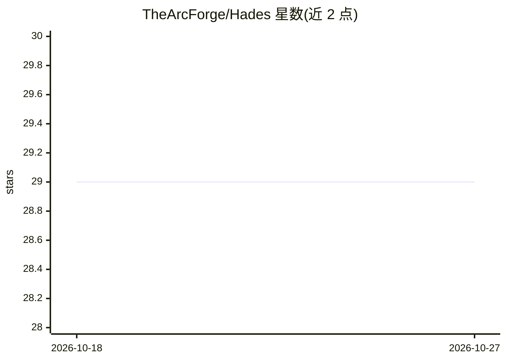

# TheArcForge/Hades

⭐ 29 · C# · MIT · 推送 2026-09-19 · [GitHub](https://github.com/TheArcForge/Hades) · 组织维护

**为 Claude Code 提供 Unity 项目知识图谱的本地 MCP 桌面应用**

macOS（Windows beta）菜单栏/托盘桌面应用，将 Unity 项目的场景、prefab、脚本、资产及其依赖索引为可查询的语义知识图谱，通过本地 MCP 服务（127.0.0.1:7823）向 Claude Code 提供 32 个工具、22 个技能与 6 个命令。另含 Charon 全量操作追踪、Asphodel 版本可控的 markdown 项目记忆；可选 Unity 插件用于实时编辑器操作。全部本地运行，内嵌核心仅支持 arm64，Windows 10 1607+ 为 beta。README 附有答案信任级别说明（结构事实可直接信任，引用/继承关系需人工确认）。

## 筛选速览

| 维度 | 判定 | 备注 |
|---|---|---|
| AI 角色 | `ai-ecosystem` | LLM/agent 周边工具 |
| 许可风险 | `permissive` | MIT |
| 部署形态 | `desktop` | 安装包/桌面程序 |
| 模型依赖 | locked-api |  |
| 硬件要求 | — | 无带数字的原话,不猜 |
| 安装摩擦 | `low` | 无编译、无系统依赖或容器化 |
| 成熟度 | `idea` | |

## 能力要点

- 32 个 MCP 工具覆盖图查询、依赖追踪、检查、项目记忆与编辑器操作
- Asphodel 以版本可控 markdown 持久化项目记忆
- Charon 记录每次工具调用、图查询与内存操作
- 可选 Unity 插件支持实时编辑器操作（编辑场景/prefab、跑测试、读控制台）

## 适用场景

- 让 Claude Code 回答 Unity 项目结构与依赖问题而无需全文检索
- 改动脚本前分析哪些 prefab 和场景会受影响
- 跨会话保留项目决策与约定的持久记忆

## 场景标签

`知识图谱` `Agent 记忆` · 领域:Agent 开发

## 证据(README 行号)

> L15: Hades is Unity-aware AI infrastructure for Claude Code. It's a **standalone desktop app** — a menu-bar app on macOS
> L50: Your agent talks to Hades over MCP on `127.0.0.1:7823`. The app indexes your project's structure into the **Graph**
> L38: |**32 MCP Tools**|Graph queries, dependency tracing, inspection, project memory, observability, and editor actions 

## 星数曲线

2026-10-18 29 → 2026-10-27 29（+0）

---
*卡片 v1 · prompt 1.4 · 生成 2026-10-26 · 置信度 high · 依据 README sha `3d10db1e0e9b` · [字段定义](../../DATASET.md)*
