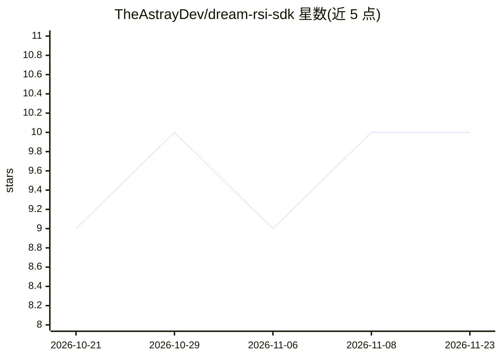

# TheAstrayDev/dream-rsi-sdk

⭐ 10 · Python · Apache-2.0 · 推送 2026-10-15 · [GitHub](https://github.com/TheAstrayDev/dream-rsi-sdk) · 个人维护

**面向已有 agent 循环的探索策略编排 SDK**

独立的非官方 Dream-RSI 风格 Python SDK（Beta，非 Google 产品）：开发者提供自己的 generate→evaluate→reflour 循环，SDK 负责尝试管理、发现树、历史回放、策略选择与完整的模型调用记账。核心零运行时依赖、不绑定模型服务商；提供 QualityContract 质量保护、LLMPolicyDeveloper 策略改写、可选 PyTorch 权重开发实验、本地 SQLite Live Inspector 与无 Docker 沙箱解释器。通过 PyPI 安装，Python 3.11+。

## 筛选速览

| 维度 | 判定 | 备注 |
|---|---|---|
| AI 角色 | `ai-ecosystem` | LLM/agent 周边工具 |
| 许可风险 | `permissive` | Apache-2.0 |
| 部署形态 | `library` | 以包/库形式分发 |
| 模型依赖 | local-ok | 支持本地模型 |
| 硬件要求 | — | 无带数字的原话,不猜 |
| 安装摩擦 | `low` | 无编译、无系统依赖或容器化 |
| 成熟度 | `idea` | |

## 能力要点

- 带 QualityContract 的质量保护与可证明停止条件、逐次请求的开销记账
- LLMPolicyDeveloper 基于模型客户端与回放反馈改写策略源码，沙箱无需 Docker
- 可安装的 Live Inspector：本地 SQLite 日志加只读浏览器查看器
- 零必需第三方依赖；权重开发为可选 [training] extra，默认权重固定

## 适用场景

- 为已有的 agent 求解循环实验分支、批量与停止策略
- 对模型调用做逐请求的准备/部署记账与成本控制
- 在已记录经验上回放比较多种探索策略
- 需要无 Docker 的受限策略沙箱执行

## 场景标签

`Agent 框架` · 领域:Agent 开发

## 证据(README 行号)

> L35: **Dream-RSI SDK** is a small Python orchestration layer for exploring candidate solutions
> L39: It is designed for developers who already have a **generate → evaluate → refine** loop
> L41: The core has no dependency on a model provider or agent framework.

## 星数曲线

2026-10-21 9 → 2026-11-23 10（+1）

---
*卡片 v1 · prompt 1.4 · 生成 2026-11-20 · 置信度 high · 依据 README sha `728983376fbd` · [字段定义](../../DATASET.md)*
