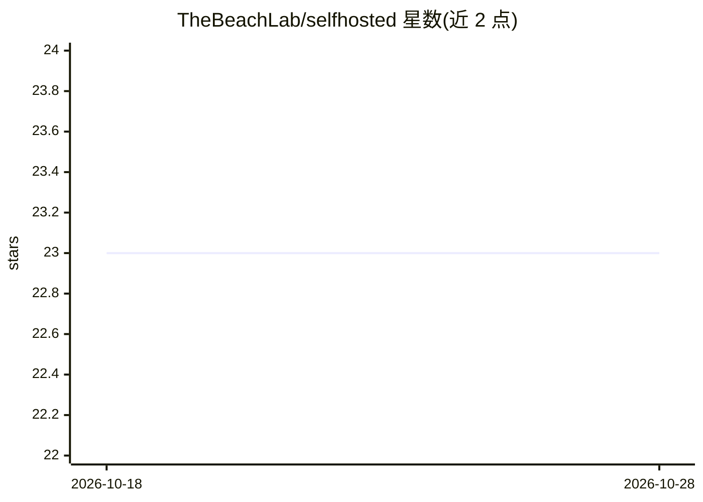

# TheBeachLab/selfhosted

⭐ 23 · Python · 推送 2026-10-14 · [GitHub](https://github.com/TheBeachLab/selfhosted) · [官网](https:/beachlab.org) · 个人维护

**个人自托管基础设施的运维文档：服务器、服务与 AI 工作负载记录**

作者 Francisco 记录自身走向自托管的文档仓库：覆盖 Intel NUC 服务器与 Tailscale 组网、RPi 5 车载遥测、Synology NAS 的配置事实，以及目录式索引——SSH 加固、备份、Nginx、Git/SFTP/VPN 服务器、Vaultwarden、MQTT 遥测、TimescaleDB/PostgREST，另有 AI/GPU 章节（Whisper、TTS、ComfyUI、eBook RAG、知识图谱 WIP）。README 自述为个人笔记，未提供安装命令，正文多为目录条目。

## 筛选速览

| 维度 | 判定 | 备注 |
|---|---|---|
| AI 角色 | `ai-knowledge` | 知识聚合/清单类 |
| 许可风险 | `none` | — |
| 部署形态 | `None` |  |
| 模型依赖 | — | README 未给出锁定关系 |
| 硬件要求 | — | 无带数字的原话,不猜 |
| 安装摩擦 | `medium` | 含编译或系统依赖之一 |
| 成熟度 | — | 结构信号不足 |

## 能力要点

- 按服务器设置、服务、监控、IoT、数据库、AI/GPU 分类的目录式文档
- 记录 NUC + eGPU 按需供电运行 Whisper/TTS/ComfyUI 的会话模式
- Tailscale 组网配置附验证日期与命令来源

## 适用场景

- 参考他人自托管基础设施的架构与踩坑记录
- 了解家用服务器上 GPU 推理服务的管理方式
- 查找特定自托管服务（如 MQTT→TimescaleDB 管道）的实现线索

## 场景标签

`教程课程` · 领域:学习与行业

## 证据(README 行号)

> L5: This is the story of how I am slowly becoming independent. Disclaimer: If you don't understand anything, that's fine
> L39: ## TOC
> L93: ### AI and GPU

## 星数曲线

2026-10-18 23 → 2026-10-28 23（+0）

---
*卡片 v1 · prompt 1.4 · 生成 2026-10-27 · 置信度 mid · 依据 README sha `5458f23bd8d2` · [字段定义](../../DATASET.md)*
