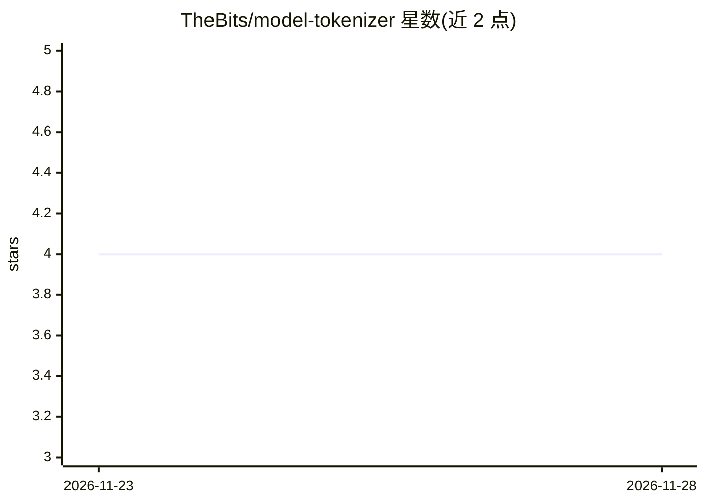

# TheBits/model-tokenizer

⭐ 4 · Python · MIT · 推送 2026-11-22 · [GitHub](https://github.com/TheBits/model-tokenizer) · 个人维护

**文本分割器的精确 token 计数客户端库**

一个 Python 客户端包，让 langchain-text-splitters 与 semantic-text-splitter 按真实 llama.cpp 或 vLLM 模型的 token 进行计数与切分，通过 /tokenize 和 /detokenize HTTP 端点实现。提供两种分割模式：纯 token 窗口（split_text_on_tokens）和以 token 度量的语义分割（length_function），并支持配合 llama-server、llama-swap、LiteLLM 等路由使用。面向需要精确填充上下文窗口的开发者；纯 token 窗口可保证硬性 token 上限但边界可能切断单词。

## 筛选速览

| 维度 | 判定 | 备注 |
|---|---|---|
| AI 角色 | `ai-ecosystem` | LLM/agent 周边工具 |
| 许可风险 | `permissive` | MIT |
| 部署形态 | `library` | 以包/库形式分发 |
| 模型依赖 | local-ok | 支持本地模型 |
| 硬件要求 | — | 无带数字的原话,不猜 |
| 安装摩擦 | `low` | 无编译、无系统依赖或容器化 |
| 成熟度 | — | 结构信号不足 |

## 能力要点

- 通过 /tokenize、/detokenize 端点按真实模型 token 计数切分
- 支持 langchain-text-splitters 与 semantic-text-splitter，无需适配器
- 支持 llama-swap、LiteLLM 等路由（发送 model 字段选择后端）
- 支持 MarkdownSplitter 与 CodeSplitter 的 from_callback 集成

## 适用场景

- 本地小模型 4k/8k 上下文窗口下按 token 精确切分文档
- 为嵌入模型检索准备尽可能填满上下文的文本块
- 按 token 度量但保留段落/句子边界的语义分割

## 场景标签

 · 领域:LLM 基础设施/文本处理

## 证据(README 行号)

> L10: The package lets `langchain-text-splitters` and
> L12: and split text by the tokens of a real **llama.cpp** or **vLLM** model, using
> L53: LangChain's character/recursive splitters accept a custom length function, so

## 星数曲线

2026-11-23 4 → 2026-11-28 4（+0）

---
*卡片 v1 · prompt 1.4 · 生成 2026-11-23 · 置信度 high · 依据 README sha `73e9c490d92d` · [字段定义](../../DATASET.md)*
