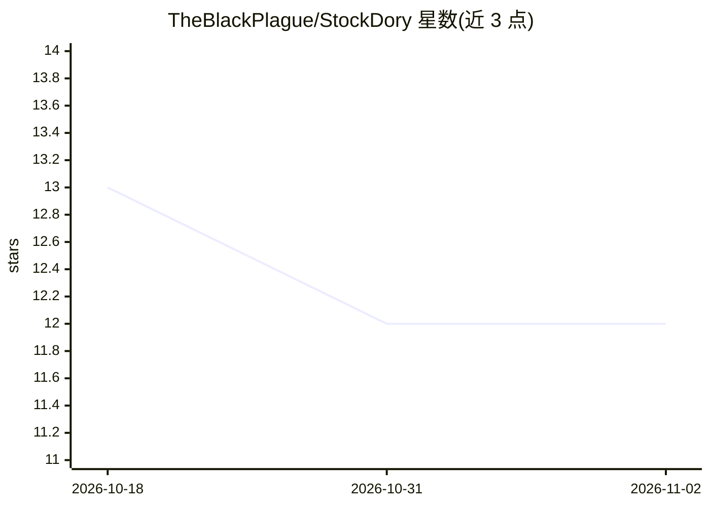

# TheBlackPlague/StockDory

⭐ 12 · C++ · AGPL-3.0 · 推送 2026-11-01 · [GitHub](https://github.com/TheBlackPlague/StockDory) · 个人维护

**现代 C++ 编写的神经网络国际象棋引擎（UCI 协议）**

StockDory 是一个用 C++23 编写的命令行国际象棋引擎，结合神经网络局面评估与深度优化的树搜索（alpha-beta 剪枝、negamax 等），通过标准输入输出以 UCI 协议通信，README 建议搭配 En Croissant 等 UCI 图形界面使用。分发方式包括面向三大桌面系统的官方发布二进制、GitHub Container Registry 官方容器镜像（容器启动时针对宿主 CPU 原生编译，目前仅支持 x86/amd64），以及本地 C++23/LLVM 工具链编译。许可为 AGPL v3.0，logo 另按 CC BY-NC-ND 4.0 授权。

## 筛选速览

| 维度 | 判定 | 备注 |
|---|---|---|
| AI 角色 | `ai-native` | 本体是模型或模型工具 |
| 许可风险 | `viral` | AGPL-3.0 |
| 部署形态 | `self-host` | docker 或自建部署 |
| 模型依赖 | — | README 未给出锁定关系 |
| 硬件要求 | — | 无带数字的原话,不猜 |
| 安装摩擦 | `low` | 无编译、无系统依赖或容器化 |
| 成熟度 | — | 结构信号不足 |

## 能力要点

- 神经网络评估与优化树搜索结合的国际象棋引擎
- 通过 UCI 协议经标准输入输出通信，可配 UCI 图形界面
- 官方容器镜像在启动时针对宿主 CPU 原生编译
- 提供官方发布二进制、容器镜像与本地 C++23/LLVM 编译三种途径

## 适用场景

- 搭配 UCI 图形界面进行对局或局面分析
- 在 Docker 容器中隔离运行国际象棋引擎
- 针对特定硬件本地编译以获得适配构建

## 场景标签

 · 领域:游戏/棋类引擎

## 证据(README 行号)

> L3:  Strong Neural Network Chess Engine
> L14: StockDory is a modern C++ chess engine combining neural-network evaluation with a deeply optimized tree search. Cap

## 星数曲线

2026-10-18 13 → 2026-11-02 12（-1）

---
*卡片 v1 · prompt 1.4 · 生成 2026-11-01 · 置信度 high · 依据 README sha `bd42fe3bafb7` · [字段定义](../../DATASET.md)*
