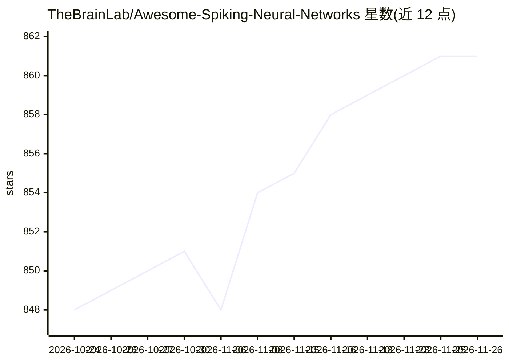

# TheBrainLab/Awesome-Spiking-Neural-Networks

⭐ 861 · 推送 2026-11-05 · [GitHub](https://github.com/TheBrainLab/Awesome-Spiking-Neural-Networks) · 组织维护 · 中文 README

**SNN（脉冲神经网络）研究者用的论文与代码持续更新清单**

脉冲神经网络方向的论文策展清单：按年份与会议/期刊（Nature、Science、AAAI、ICLR、ICML、NeurIPS 等）组织条目，每条附论文链接，部分附代码链接；通过 pull request 接受社区补充收录，README 中的 News 区逐条记录历次更新及收录论文数量，声明持续更新中。

## 筛选速览

| 维度 | 判定 | 备注 |
|---|---|---|
| AI 角色 | `ai-knowledge` | 知识聚合/清单类 |
| 许可风险 | `none` | — |
| 部署形态 | `None` |  |
| 模型依赖 | — | README 未给出锁定关系 |
| 硬件要求 | — | 无带数字的原话,不猜 |
| 安装摩擦 | `low` | 无编译、无系统依赖或容器化 |
| 成熟度 | — | 结构信号不足 |

## 能力要点

- 按会议/期刊与年份组织的 SNN 论文列表，附论文链接
- 部分条目附带开源代码链接
- 通过 pull request 接受社区补充论文
- News 区记录历次更新（含 AAAI 2026、ICLR 2026、ICML 2026、NeurIPS 2025 等批次）

## 适用场景

- 查找脉冲神经网络方向的顶会与 CNS 期刊论文
- 寻找带开源代码的 SNN 研究工作
- 跟踪 SNN 领域最新论文动态

## 场景标签

`精选清单` · 领域:学习与行业

## 证据(README 行号)

> L3: Collect some spiking neural network papers & codes. (**Actively keep updating**)
> L49: ## Papers
> L53: **Nature, Science**

## 星数曲线

2026-10-24 848 → 2026-11-26 861（+13）

---
*卡片 v1 · prompt 1.4 · 生成 2026-11-24 · 置信度 high · 依据 README sha `8a5702ad902f` · [字段定义](../../DATASET.md)*
