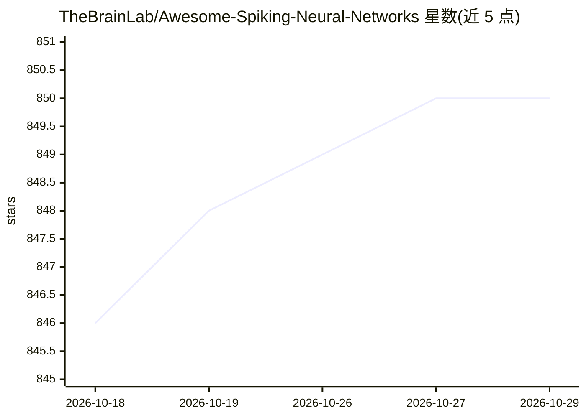

# TheBrainLab/Awesome-Spiking-Neural-Networks

⭐ 850 · 推送 2026-10-06 · [GitHub](https://github.com/TheBrainLab/Awesome-Spiking-Neural-Networks) · 组织维护 · 中文 README

**脉冲神经网络论文与代码聚合清单**

收集脉冲神经网络（SNN）相关的顶会顶刊及 CNS 论文与代码的聚合清单，条目按年份与会议（AAAI、ICLR、ICML、NeurIPS、CVPR、Nature/Science/Cell 等）组织，附 News 更新日志记录各批次收录情况，自述持续更新中，支持通过 pull request 补充条目。面向 SNN 与类脑计算方向的研究者，用于追踪该领域的论文产出。

## 筛选速览

| 维度 | 判定 | 备注 |
|---|---|---|
| AI 角色 | `ai-knowledge` | 知识聚合/清单类 |
| 许可风险 | `none` | — |
| 部署形态 | `None` |  |
| 模型依赖 | — | README 未给出锁定关系 |
| 硬件要求 | — | 无带数字的原话,不猜 |
| 安装摩擦 | `low` | 无编译、无系统依赖或容器化 |
| 成熟度 | — | 结构信号不足 |

## 能力要点

- 按年份与会议组织的 SNN 论文条目（含 paper 链接）
- News 日志记录每次收录的会议与论文数量
- 开放 pull request 补充遗漏论文

## 适用场景

- 追踪各顶会脉冲神经网络方向的最新论文
- 查找 SNN 训练、转换、应用类论文线索
- 了解 2024-2026 年 SNN 研究的收录概况

## 场景标签

`精选清单` · 领域:学习与行业

## 证据(README 行号)

> L1: # Awesome Spiking Neural NetworksAwesome
> L3: Collect some spiking neural network papers & codes. (**Actively keep updating**)

## 星数曲线

2026-10-18 846 → 2026-10-29 850（+4）

---
*卡片 v1 · prompt 1.4 · 生成 2026-10-21 · 置信度 high · 依据 README sha `24b30c1c25d4` · [字段定义](../../DATASET.md)*
