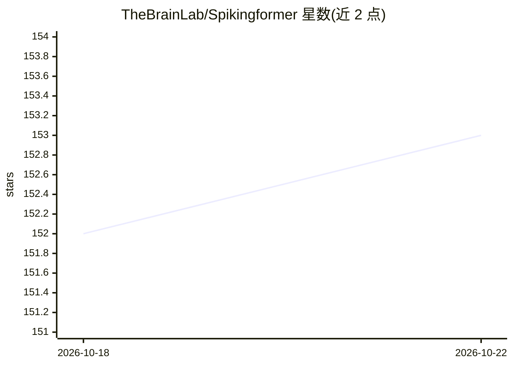

# TheBrainLab/Spikingformer

⭐ 153 · Python · Apache-2.0 · 推送 2026-04-16 · [GitHub](https://github.com/TheBrainLab/Spikingformer) · 组织维护

**纯事件驱动 Transformer 脉冲神经网络模型及训练代码（AAAI 2026）**

基于 PyTorch 与 SpikingJelly 实现的脉冲驱动残差学习 Transformer 结构脉冲神经网络（SNN），论文被 AAAI 2026 接收，报告 ImageNet-1K 上 75.85% top-1 精度，并给出参数量、FLOPs、功耗（mJ）与能耗对比数据。提供 ImageNet-1K、CIFAR10/100、CIFAR10-DVS、DVS128 Gesture 的训练与测试脚本、yaml 超参配置、能耗计算脚本及部分预训练模型下载（密码 abcd）。依赖 timm/cupy/torch/spikingjelly，面向脉冲神经网络与神经形态计算研究者。

## 筛选速览

| 维度 | 判定 | 备注 |
|---|---|---|
| AI 角色 | `ai-native` | 本体是模型或模型工具 |
| 许可风险 | `permissive` | Apache-2.0 |
| 部署形态 | `None` |  |
| 模型依赖 | — | README 未给出锁定关系 |
| 硬件要求 | — | 无带数字的原话,不猜 |
| 安装摩擦 | `low` | 无编译、无系统依赖或容器化 |
| 成熟度 | — | 结构信号不足 |

## 能力要点

- 纯事件驱动 Transformer 结构 SNN，ImageNet-1K 75.85% top-1
- 提供 ImageNet/CIFAR/DVS 多数据集训练与测试脚本
- 提供 ImageNet 能耗计算脚本与对比数据
- 提供部分预训练模型下载

## 适用场景

- 复现或改进脉冲 Transformer 模型的实验
- 在神经形态数据集（DVS128 Gesture、CIFAR10-DVS）上训练 SNN
- 测算与对比 SNN 推理能耗

## 场景标签

`模型训练` · 领域:训练与推理

## 证据(README 行号)

> L4: Spikingformer is a pure event-driven transformer-based spiking neural network (**75.85% top-1** accuracy on ImageNet
> L63: ## Train
> L105: ### Energy Consumption Calculation on ImageNet

## 星数曲线

2026-10-18 152 → 2026-10-22 153（+1）

---
*卡片 v1 · prompt 1.4 · 生成 2026-10-22 · 置信度 high · 依据 README sha `e9ac26a06bfd` · [字段定义](../../DATASET.md)*
