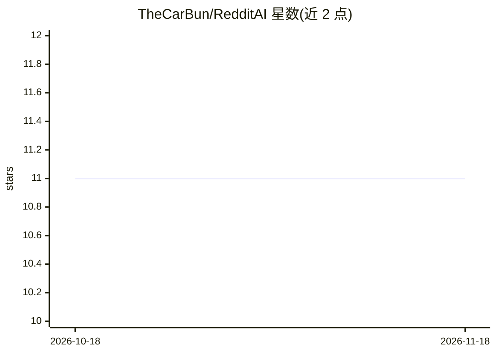

# TheCarBun/RedditAI

⭐ 11 · Python · MIT · 推送 2026-06-20 · [GitHub](https://github.com/TheCarBun/RedditAI) · [官网](https://reddit-ai-one.vercel.app) · 个人维护

**给 Reddit 用户：用 Gemini 生成帖子评论的 AI 摘要**

基于 Flask 的 Web 应用：用户粘贴 Reddit 帖子 URL，应用通过 PRAW 调用 Reddit API 拉取该帖全部评论，交给由 agno 框架驱动的 Gemini agent 生成摘要或洞察，以 Markdown 形式展示在网页界面。需自备 Reddit API 凭据与 Gemini API Key（.env 配置）；Reddit 侧以只读模式运行；agent 的总结指令与工具可在 instructions.py 中自定义扩展。安装为 git clone 后 pip 装依赖、python 启动，运行于 localhost:5000。

## 筛选速览

| 维度 | 判定 | 备注 |
|---|---|---|
| AI 角色 | `ai-native` | 本体是模型或模型工具 |
| 许可风险 | `permissive` | MIT |
| 部署形态 | `library` | 以包/库形式分发 |
| 模型依赖 | — | README 未给出锁定关系 |
| 硬件要求 | — | 无带数字的原话,不猜 |
| 安装摩擦 | `low` | 无编译、无系统依赖或容器化 |
| 成熟度 | — | 结构信号不足 |

## 能力要点

- PRAW 拉取 Reddit 帖子评论，只读模式运行
- agno 框架的 Gemini agent 生成摘要/洞察
- Flask 网页界面，Markdown 展示结果
- agent 指令与工具可在 instructions.py 中自定义

## 适用场景

- 快速了解某个 Reddit 帖子讨论区的整体观点
- 对 Reddit 帖子评论做主题性分析
- 在此基础上扩展自己的 Reddit 分析 agent

## 场景标签

`AI 助手` · 领域:对话与助手

## 证据(README 行号)

> L3: 🎃 **RedditAI** is a Flask web app that leverages Google Gemini and the Reddit API to fetch Reddit post comments and 
> L16: 3. **AI Summarization:** Comments are passed to a Gemini-powered agent, which generates a summary or insight.

## 星数曲线

2026-10-18 11 → 2026-11-18 11（+0）

---
*卡片 v1 · prompt 1.4 · 生成 2026-11-18 · 置信度 high · 依据 README sha `c99be8f6da80` · [字段定义](../../DATASET.md)*
