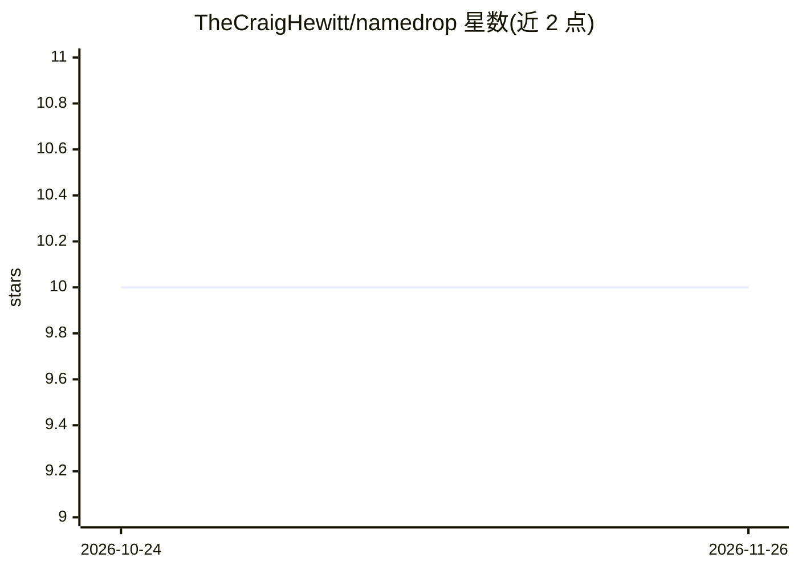

# TheCraigHewitt/namedrop

⭐ 10 · TypeScript · MIT · 推送 2026-10-29 · [GitHub](https://github.com/TheCraigHewitt/namedrop) · 个人维护

**自托管的 AI 答案中品牌提及追踪器，部署于 Cloudflare Worker**

NameDrop 是一个自托管的品牌提及追踪器：单个 Cloudflare Worker 每日定时从 ChatGPT、Perplexity 和 Gemini 获取 AI 助手对预设提示词的回答，检测品牌提及，并提供仪表盘与 CSV 导出。它定位为托管型 AEO 追踪服务的替代方案。核心机制包括：Astro 仪表盘提供五个视图（趋势、提示词指标、运行记录、来源、健康度）、D1 存储、通过 Cloudflare Access 做鉴权、配置文件以 git 提交方式驱动追踪项同步。ChatGPT 采集依赖付费的 cloro.dev 计划（Lite 或以上），文档指出该路径处于 ToS 灰色地带。

## 筛选速览

| 维度 | 判定 | 备注 |
|---|---|---|
| AI 角色 | `ai-enhanced` | 去掉 AI 部分产品仍成立 |
| 许可风险 | `permissive` | MIT |
| 部署形态 | `library` | 以包/库形式分发 |
| 模型依赖 | — | README 未给出锁定关系 |
| 硬件要求 | — | 无带数字的原话,不猜 |
| 安装摩擦 | `low` | 无编译、无系统依赖或容器化 |
| 成熟度 | — | 结构信号不足 |

## 能力要点

- 每日定时采集 ChatGPT、Perplexity、Gemini 三类 AI 助手回答并检测品牌提及
- 仪表盘五个视图：可见性趋势、提示词指标、运行记录、来源分析、采集健康度
- 追踪配置以 JSON 文件版本化管理，通过 API 同步到 D1
- Peec 形状的 CSV 导出供下游内容工具使用

## 适用场景

- 追踪我的品牌和竞品在 AI 助手回答中的出现频率
- 用 AI 回答中的来源域名数据指导内容策略
- 自托管替代付费的托管 AEO 追踪服务

## 场景标签

 · 领域:AI 搜索优化/品牌监控

## 证据(README 行号)

> L3: Does ChatGPT name-drop you? NameDrop is a self-hosted tracker for how often
> L28: - `fetch` — the Astro dashboard and the CSV export endpoints.

## 星数曲线

2026-10-24 10 → 2026-11-26 10（+0）

---
*卡片 v1 · prompt 1.4 · 生成 2026-11-20 · 置信度 high · 依据 README sha `efedf02e24e1` · [字段定义](../../DATASET.md)*
