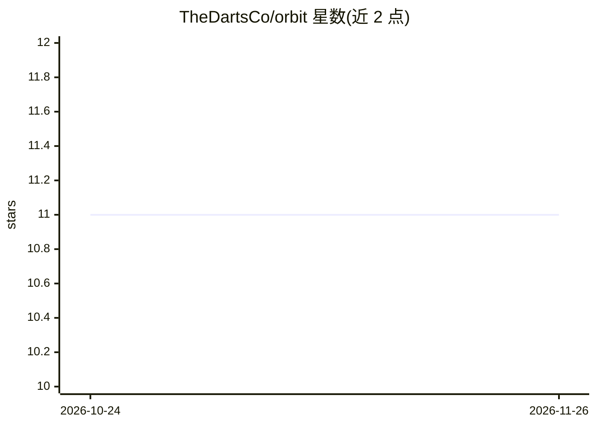

# TheDartsCo/orbit

⭐ 11 · Rust · MIT · 推送 2026-08-24 · [GitHub](https://github.com/TheDartsCo/orbit) · 个人维护

**给开发者统一搜索与续接多个 AI 编码代理本地会话的桌面浏览器**

Orbit 是一个 AI 编码代理的原生会话浏览器（Tauri v2 + React + Rust）：自动发现本机已安装代理的会话文件，解析归一化到本地 SQLite 索引，支持按代理、项目、模型、分支、日期过滤，搜索标题、消息、工具调用与输出，查看用量统计与时间线，并在 macOS/Linux 上直接续接支持代理的会话。全部数据留在本地，不修改代理原始会话文件；macOS 为主发布平台，Windows 发现能力待原生验证，Linux 限本地开发。

## 筛选速览

| 维度 | 判定 | 备注 |
|---|---|---|
| AI 角色 | `ai-ecosystem` | LLM/agent 周边工具 |
| 许可风险 | `permissive` | MIT |
| 部署形态 | `desktop` | 安装包/桌面程序 |
| 模型依赖 | — | README 未给出锁定关系 |
| 硬件要求 | — | 无带数字的原话,不猜 |
| 安装摩擦 | `medium` | 含编译或系统依赖之一 |
| 成熟度 | `idea` | |

## 能力要点

- 为 Claude Code、Codex、Cursor 等 13 个代理提供统一会话索引与搜索
- 本地 SQLite 索引，不上传转录，不修改代理原始会话文件
- macOS/Linux 一键续接（Resume）会话到首选终端
- 虚拟化列表与增量索引（解析器版本 + 文件哈希跳过未变文件）

## 适用场景

- 找回散落在 Claude Code/Codex/Warp 等工具里的历史调试会话
- 跨代理按项目和模型检索过去的实现过程
- 从统一界面直接续接上一次编码任务

## 场景标签

 · 领域:开发者工具/AI 编码代理会话管理

## 证据(README 行号)

> L13: Orbit is a native session browser for AI coding agents. It finds the session
> L144: Orbit is a Tauri v2 desktop app with a React frontend and Rust backend.

## 星数曲线

2026-10-24 11 → 2026-11-26 11（+0）

---
*卡片 v1 · prompt 1.4 · 生成 2026-11-18 · 置信度 high · 依据 README sha `095d36c68244` · [字段定义](../../DATASET.md)*
