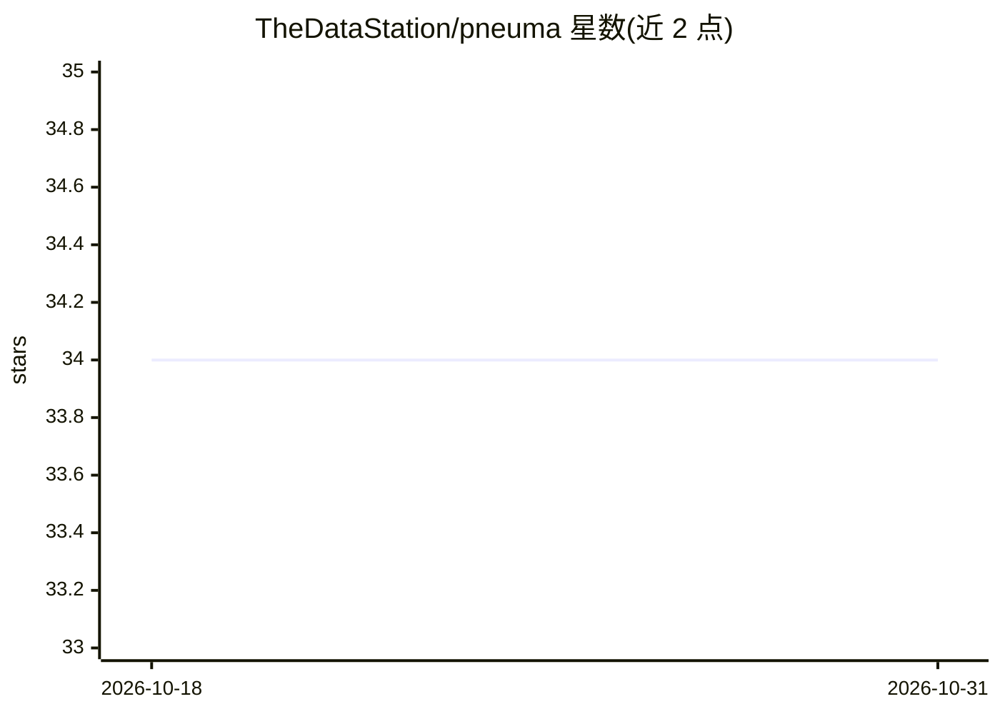

# TheDataStation/pneuma

⭐ 34 · Python · MIT · 推送 2026-04-07 · [GitHub](https://github.com/TheDataStation/pneuma) · [官网](https://thedatastation.github.io/pneuma/) · 组织维护

**面向表格数据的 LLM 数据发现系统：自然语言查表**

Pneuma 是一个基于 LLM 的表格数据发现系统：给定自然语言查询，它在已索引的表格集合中检索最相关的表。检索同时利用内容（列与行）和上下文（元数据）进行匹配。项目后续扩展为 Pneuma-Seeker（agentic 数据发现与准备系统）。使用方式包括 Colab notebook、Python API 与 CLI；本地运行需 OpenAI API token 或至少 20 GB 显存的本地 GPU，推荐通过 Miniconda 安装并配置 CUDA Toolkit。配有 arXiv 论文。

## 筛选速览

| 维度 | 判定 | 备注 |
|---|---|---|
| AI 角色 | `ai-native` | 本体是模型或模型工具 |
| 许可风险 | `permissive` | MIT |
| 部署形态 | `library` | 以包/库形式分发 |
| 模型依赖 | — | README 未给出锁定关系 |
| 硬件要求 | — | 无带数字的原话,不猜 |
| 安装摩擦 | `medium` | 含编译或系统依赖之一 |
| 成熟度 | — | 结构信号不足 |

## 能力要点

- 自然语言查询检索最相关表格
- 结合内容（列/行）与上下文（元数据）双通道匹配
- 提供 Colab 演示、Python API、CLI 三种使用方式

## 适用场景

- 在大量表格集合中用自然语言查找所需数据表
- 数据发现与表格检索的科研实验
- 无需本地安装，通过 Colab 快速试用

## 场景标签

`语义搜索` `科研工具` · 领域:知识与检索

## 证据(README 行号)

> L9: `Pneuma` is an LLM-powered data discovery system for tabular data. Given a natural language query,
> L10: `Pneuma` searches an indexed collection and retrieves the most relevant tables for the question. It performs this s

## 星数曲线

2026-10-18 34 → 2026-10-31 34（+0）

---
*卡片 v1 · prompt 1.4 · 生成 2026-10-25 · 置信度 high · 依据 README sha `eb9befac3bab` · [字段定义](../../DATASET.md)*
