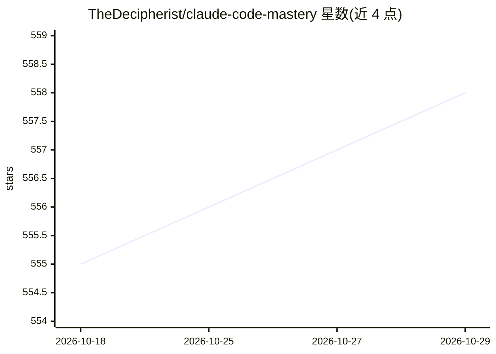

# TheDecipherist/claude-code-mastery

⭐ 558 · Shell · MIT · 推送 2026-05-07 · [GitHub](https://github.com/TheDecipherist/claude-code-mastery) · [官网](https://thedecipherist.com?utm_source=github&utm_medium=repo&utm_campaign=claude-code-mastery&utm_content=about-link    ) · 个人维护

**Claude Code 使用指南与配置模板库（V2 已废弃）**

面向 Claude Code 用户的教学仓库：完整指南 GUIDE.md 讲解全局 CLAUDE.md、MCP 服务器、自定义命令、Hooks、Skills 与单一用途对话等用法，附模板与技能文件供复制到 ~/.claude/ 目录。核心论点之一是 Hooks 提供确定性强制执行而 CLAUDE.md 规则仅为建议。README 标注 V2 版本已废弃，指向新的 Starter Kit 与独立 npm 包 MDD（21 种模式的手册驱动开发工具）。前置要求 Claude Code、Python 3.8+ 与 jq。

## 筛选速览

| 维度 | 判定 | 备注 |
|---|---|---|
| AI 角色 | `ai-knowledge` | 知识聚合/清单类 |
| 许可风险 | `permissive` | MIT |
| 部署形态 | `library` | 以包/库形式分发 |
| 模型依赖 | — | README 未给出锁定关系 |
| 硬件要求 | — | 无带数字的原话,不猜 |
| 安装摩擦 | `low` | 无编译、无系统依赖或容器化 |
| 成熟度 | — | 结构信号不足 |

## 能力要点

- 覆盖 CLAUDE.md、Hooks、Skills、MCP 服务器、自定义命令的完整指南
- 提供 hooks/skills/settings 模板，按步骤复制到 ~/.claude/ 安装
- 强调 Hooks 退出码 2 的阻断式强制执行机制
- 新版 MDD 为独立 npm 包，含 21 种开发模式

## 适用场景

- 系统学习 Claude Code 的配置与扩展机制
- 复制模板快速搭建全局 CLAUDE.md 与 Hooks 环境
- 了解如何用 Hooks 阻止 AI 访问敏感文件

## 场景标签

`教程课程` · 领域:学习与行业

## 证据(README 行号)

> L15: The complete guide to maximizing Claude Code: Global CLAUDE.md, MCP Servers, Commands, Hooks, Skills, and Why Singl
> L42: ## 📖 The Guide

## 星数曲线

2026-10-18 555 → 2026-10-29 558（+3）

---
*卡片 v1 · prompt 1.4 · 生成 2026-10-22 · 置信度 high · 依据 README sha `442c9c9da927` · [字段定义](../../DATASET.md)*
