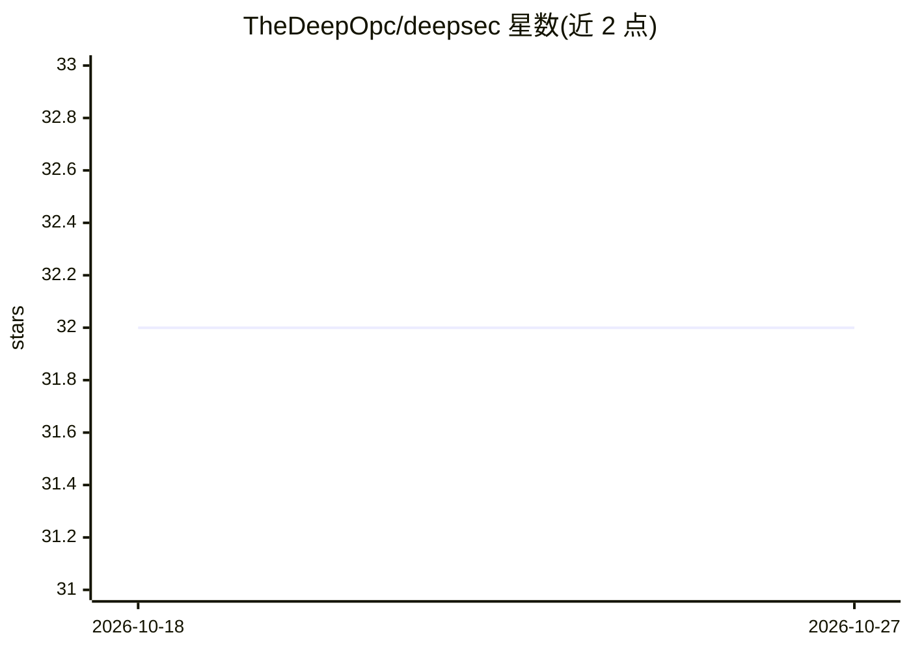

# TheDeepOpc/deepsec

⭐ 32 · Python · 推送 2026-02-24 · [GitHub](https://github.com/TheDeepOpc/deepsec) · 个人维护

**结合 SAST 规则与 Llama 3.3 推理的代码安全审计工具**

面向安全研究人员与开发者的静态应用安全测试（SAST）平台：以正则模式结合 Llama 3.3（经 Groq API 调用，需自备 API key）进行混合分析，覆盖 OWASP 2025 多类漏洞（注入、访问控制、反序列化等），支持 PHP、Python、JavaScript、Java、Go、C#、Rust、Ruby 八种语言并自动应用对应规则。支持从 GitHub 克隆远程仓库审计、AI 生成 PoC 与交互式 HTML 报告，界面支持英语/俄语/乌兹别克语。需联网调用 Groq API，通过 git clone 源码方式安装。

## 筛选速览

| 维度 | 判定 | 备注 |
|---|---|---|
| AI 角色 | `ai-native` | 本体是模型或模型工具 |
| 许可风险 | `none` | — |
| 部署形态 | `None` |  |
| 模型依赖 | locked-api |  |
| 硬件要求 | — | 无带数字的原话,不猜 |
| 安装摩擦 | `low` | 无编译、无系统依赖或容器化 |
| 成熟度 | — | 结构信号不足 |

## 能力要点

- 正则模式与 Llama 3.3 深度推理的混合分析
- 覆盖 OWASP A01/A02/A05/A08/A10:2025 类漏洞检测
- 支持 8 种编程语言并自动应用对应安全规则集
- AI 生成 PoC 利用代码与交互式 HTML 报告

## 适用场景

- 对本地或 GitHub 远程仓库做安全审计
- 查找注入、反序列化、硬编码密钥等 OWASP 类漏洞
- 生成含修复建议的审计报告用于整改

## 场景标签

`代码审查` · 领域:编码与开发

## 证据(README 行号)

> L3: DeepSec is a high-performance security auditing platform that combines **Static Application Security Testing (SAST)*
> L47: |**Hybrid Analysis**|Combines fast Regex patterns with Deep AI reasoning.|

## 星数曲线

2026-10-18 32 → 2026-10-27 32（+0）

---
*卡片 v1 · prompt 1.4 · 生成 2026-10-26 · 置信度 high · 依据 README sha `e6e61001188f` · [字段定义](../../DATASET.md)*
