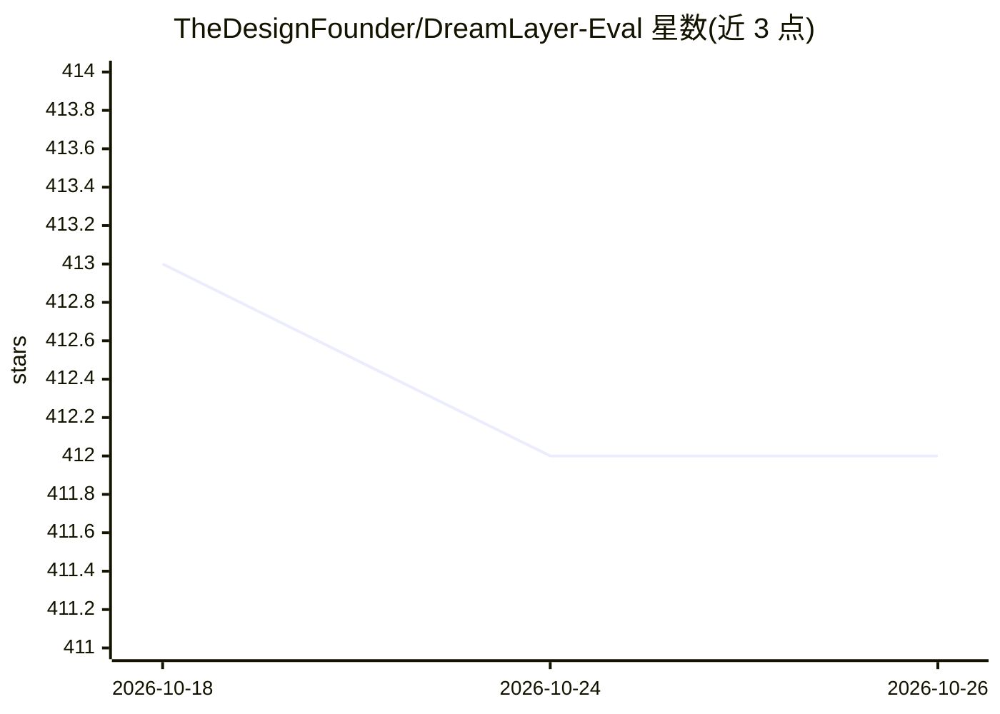

# TheDesignFounder/DreamLayer-Eval

⭐ 412 · Python · GPL-3.0 · 推送 2026-09-09 · [GitHub](https://github.com/TheDesignFounder/DreamLayer-Eval) · [官网](https://dreamlayer.io/opensource) · 组织维护

**图像/视频扩散模型的开源基准评测平台**

面向 AI 研究者、ML 工程师与实验室的开源评测工具：自动运行提示词×种子×采样器的批量生成，内置 CLIPScore、FID、LAION 美学、YOLO 构图、FVD/SSIM/PSNR/LPIPS/DINO 一致性等图像与视频指标，结果持久化到 SQLite 并支持 CSV/ZIP 导出与任意两次运行对比。本地运行：React 前端 + Flask 服务 + ComfyUI 集成；可调用 OpenAI/Flux/Ideogram 等闭源 API，也可加载 Hugging Face/Civitai 的开源权重。部分视频指标改编自 VBench（CVPR 2024）。GPL-3.0 许可。

## 筛选速览

| 维度 | 判定 | 备注 |
|---|---|---|
| AI 角色 | `ai-ecosystem` | LLM/agent 周边工具 |
| 许可风险 | `viral` | GPL-3.0 |
| 部署形态 | `library` | 以包/库形式分发 |
| 模型依赖 | — | README 未给出锁定关系 |
| 硬件要求 | `cpu-ok` | |
| 安装摩擦 | `medium` | 含编译或系统依赖之一 |
| 成熟度 | — | 结构信号不足 |

## 能力要点

- 批量提示词×种子×采样器自动基准，指标在生成时实时计算
- 内置图像与视频指标（CLIPScore/FID/YOLO 构图/FVD/DINO 一致性等），自定义指标可插拔
- 每次运行持久化到 SQLite，可按 run_id 重放并对比任意两次运行
- 支持 CUDA/MPS/CPU 运行，支持闭源 API 模型与本地开源权重两种接入方式

## 适用场景

- 对比多个扩散模型在不同提示词与种子下的质量
- 为论文或排行榜导出含指标与配置的评测报告
- 为团队搭建内部的生成模型基准工作流
- 测试 checkpoint、LoRA 与工作流的效果差异

## 场景标签

`模型评测` · 领域:评测与运维

## 证据(README 行号)

> L19: DreamLayer Eval is an open-source benchmarking and evaluation platform for image generation models and video genera
> L25: - **AI researchers** comparing diffusion models across prompts, seeds, and metrics
> L27: - **Labs and teams** building internal benchmarking workflows for generative models

## 星数曲线

2026-10-18 413 → 2026-10-26 412（-1）

---
*卡片 v1 · prompt 1.4 · 生成 2026-10-21 · 置信度 mid · 依据 README sha `d6f879028c0a` · [字段定义](../../DATASET.md)*
