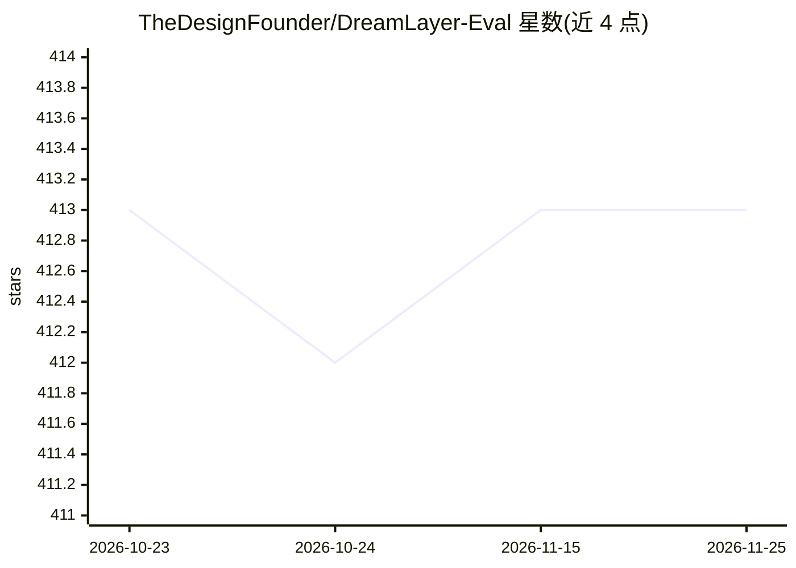

# TheDesignFounder/DreamLayer-Eval

⭐ 413 · Python · GPL-3.0 · 推送 2026-10-30 · [GitHub](https://github.com/TheDesignFounder/DreamLayer-Eval) · [官网](https://dreamlayer.io/opensource) · 组织维护

**图像/视频扩散模型评测工作台：可复现实验与指标审计**

本地运行的图像与视频生成评测工作台，与既有 ComfyUI 生成接口配套：创建带版本号的实验、导入媒体、检查指标失败项、运行可配置的图像/帧判分器（含 CLIP、YOLO、FID、OpenAI/Anthropic 判分适配器）、收集盲评人工标注、配对比较并导出可移植实验包。不预设研究问题或模型排名；对未验证能力（VQAScore、DINO、LPIPS、I3D 等）和测量语义边界逐条声明。研究执行器要求 POSIX 文件锁，Windows 原生运行不受支持，需经 WSL2。

## 筛选速览

| 维度 | 判定 | 备注 |
|---|---|---|
| AI 角色 | `ai-ecosystem` | LLM/agent 周边工具 |
| 许可风险 | `viral` | GPL-3.0 |
| 部署形态 | `library` | 以包/库形式分发 |
| 模型依赖 | — | README 未给出锁定关系 |
| 硬件要求 | — | 无带数字的原话,不猜 |
| 安装摩擦 | `medium` | 含编译或系统依赖之一 |
| 成熟度 | `idea` | |

## 能力要点

- 创建版本化实验、导出可移植实验包，不预设模型排名
- 内置 CLIP/YOLO/FID 等指标与可配置图像/帧判分器
- OpenAI/Anthropic 判分适配器支持逐点/成对评测、缓存续跑与精确重放
- 逐条声明已验证/未验证能力与测量语义边界

## 适用场景

- 对扩散模型生成结果做可复现的自动化指标评测
- 组织盲评人工标注并做配对比较分析
- 为图像/视频生成实验建立带版本记录与失败审计的流程

## 场景标签

`模型评测` · 领域:评测与运维

## 证据(README 行号)

> L3: A local workbench for reproducible image and video evaluation, with an existing
> L6: Create versioned experiments, import media, inspect metric failures, run configurable
> L11: **Platform scope:** the research executor requires POSIX file locking. Use Python

## 星数曲线

2026-10-23 413 → 2026-11-25 413（+0）

---
*卡片 v1 · prompt 1.4 · 生成 2026-11-25 · 置信度 high · 依据 README sha `c3032d2d4f82` · [字段定义](../../DATASET.md)*
