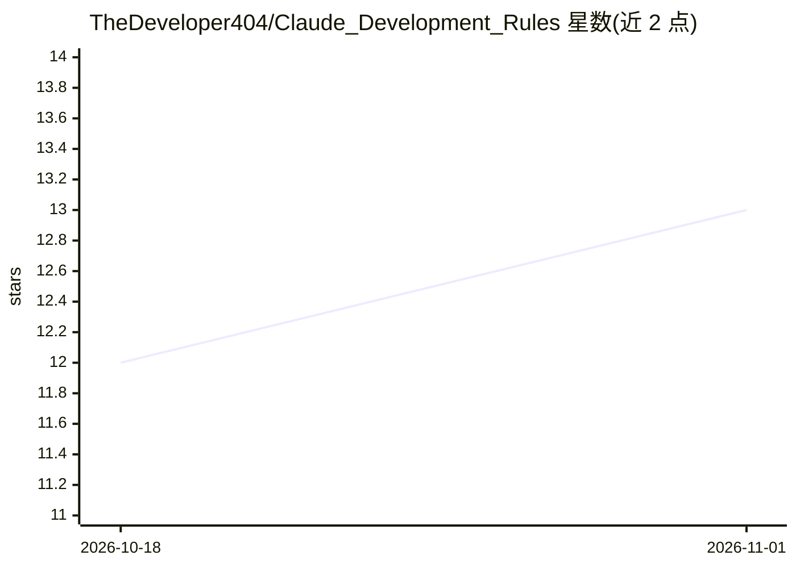

# TheDeveloper404/Claude_Development_Rules

⭐ 13 · Shell · MIT · 推送 2026-06-18 · [GitHub](https://github.com/TheDeveloper404/Claude_Development_Rules) · 个人维护

**面向 Claude 的软件工程团队规则体系：按任务复杂度适配流程**

一套 Markdown 规则与配置文件，模拟软件工程团队运作：Claude 担任首席工程师，按任务复杂度（SMALL/NORMAL/CRITICAL）适配流程，按需激活安全、架构、代码评审、QA、DevOps、性能等 6 个子代理角色。包含操作模式文档、工程标准（SOLID/DRY、13 类安全审计清单、CI/CD、UI/UX 规则）、功能规格模板，以及通过 .claude/settings.json 注册的 6 个强制执行 Hook（拦截测试、密钥扫描、保护主分支等）和斜杠命令。文档间冲突按既定优先级裁决。

## 筛选速览

| 维度 | 判定 | 备注 |
|---|---|---|
| AI 角色 | `ai-ecosystem` | LLM/agent 周边工具 |
| 许可风险 | `permissive` | MIT |
| 部署形态 | `None` |  |
| 模型依赖 | locked-api |  |
| 硬件要求 | — | 无带数字的原话,不猜 |
| 安装摩擦 | `low` | 无编译、无系统依赖或容器化 |
| 成熟度 | — | 结构信号不足 |

## 能力要点

- 按任务复杂度 SMALL/NORMAL/CRITICAL 适配流程强度
- 6 个隔离上下文子代理（安全/架构/评审/QA/DevOps/性能）
- 6 个强制执行 Hook：测试拦截、检查点、循环计数、密钥扫描、主分支保护
- 文档冲突裁决优先级与共享失败反馈日志（FEEDBACK_LOG.md）

## 适用场景

- 为 Claude 编码会话配置分层的工程规范与流程
- 在 Claude Code 中启用 Hook 与子代理做安全审计和代码评审
- 跨项目复用全局身份模板与功能规格模板

## 场景标签

`提示工程` · 领域:Agent 开发

## 证据(README 行号)

> L9: The system simulates a software engineering team. Claude acts as the lead engineer and adapts its process based on t
> L48: |.claude/settings.json|Hook wiring — all 6 enforcement hooks registered here|

## 星数曲线

2026-10-18 12 → 2026-11-01 13（+1）

---
*卡片 v1 · prompt 1.4 · 生成 2026-10-31 · 置信度 high · 依据 README sha `d78eef163a1d` · [字段定义](../../DATASET.md)*
