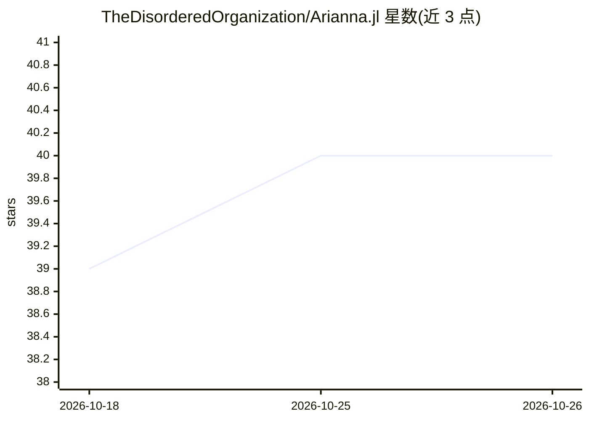

# TheDisorderedOrganization/Arianna.jl

⭐ 40 · Julia · MIT · 推送 2026-10-08 · [GitHub](https://github.com/TheDisorderedOrganization/Arianna.jl) · 组织维护

**给科研用户的模块化蒙特卡洛模拟框架（Julia）**

Julia 编写的通用蒙特卡洛模拟框架：提供 Metropolis-Hastings 等核心采样算法，用户自定义系统、move 与提议分布，包含少量预定义系统示例，更复杂系统由伴生仓库（如 ParticlesMC）提供。特色是策略梯度引导的自适应采样，可动态优化 move 参数。要求 Julia 1.9+，通过 Julia 包管理器安装；附 particle_1D 等示例脚本展示多链采样与轨迹数据存储。

## 筛选速览

| 维度 | 判定 | 备注 |
|---|---|---|
| AI 角色 | `ai-ecosystem` | LLM/agent 周边工具 |
| 许可风险 | `permissive` | MIT |
| 部署形态 | `None` |  |
| 模型依赖 | — | README 未给出锁定关系 |
| 硬件要求 | — | 无带数字的原话,不猜 |
| 安装摩擦 | `low` | 无编译、无系统依赖或容器化 |
| 成熟度 | — | 结构信号不足 |

## 能力要点

- 模块化结构，用户自定义系统、move 与提议分布
- 内置 Metropolis-Hastings，可扩展 event-chain Monte Carlo 等技术
- 策略梯度方法驱动的自适应采样优化 move 参数
- 预定义示例系统与伴生仓库 ParticlesMC

## 适用场景

- 科研人员搭建自定义系统的蒙特卡洛模拟
- 用策略梯度动态优化采样参数
- 在统计物理等领域做多链 Metropolis 采样并存储轨迹数据

## 场景标签

`科研工具` · 领域:学习与行业

## 证据(README 行号)

> L9: Arianna is a flexible and extensible framework for Monte Carlo simulations. Instead of acting as a black-box simulat
> L15: - **Policy-Guided Monte Carlo**: Integrates adaptive sampling using policy gradient methods to optimise move parame

## 星数曲线

2026-10-18 39 → 2026-10-26 40（+1）

---
*卡片 v1 · prompt 1.4 · 生成 2026-10-25 · 置信度 mid · 依据 README sha `de15eb280aa2` · [字段定义](../../DATASET.md)*
