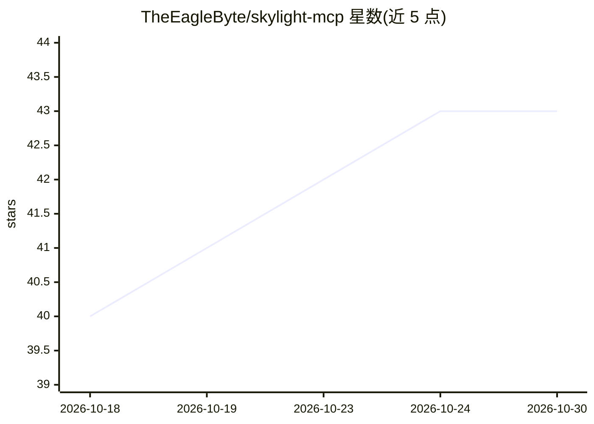

# TheEagleByte/skylight-mcp

⭐ 43 · TypeScript · MIT · 推送 2025-12-30 · [GitHub](https://github.com/TheEagleByte/skylight-mcp) · 个人维护

**让 AI 助手管理 Skylight 家庭日历的 MCP 服务器**

基于逆向工程的 Skylight API 封装成 MCP (Model Context Protocol) 服务器，使 Claude 等 AI 助手能够查询日历事件、查看和创建家务、读写购物清单与任务、查看家庭成员/设备及奖励积分。提供 npm 包与源码两种安装方式，需 Node.js 18+、Skylight 订阅账户与 Frame ID；支持邮箱密码自动登录或手动 Token 两种认证。部分工具（奖励、餐食、照片）需 Skylight Plus 订阅；属非官方集成，API 可能随时变更。

## 筛选速览

| 维度 | 判定 | 备注 |
|---|---|---|
| AI 角色 | `ai-ecosystem` | LLM/agent 周边工具 |
| 许可风险 | `permissive` | MIT |
| 部署形态 | `library` | 以包/库形式分发 |
| 模型依赖 | — | README 未给出锁定关系 |
| 硬件要求 | — | 无带数字的原话,不猜 |
| 安装摩擦 | `low` | 无编译、无系统依赖或容器化 |
| 成熟度 | — | 结构信号不足 |

## 能力要点

- 日历/家务/清单/任务/家庭/奖励六类 MCP 工具
- 邮箱密码自动登录与手动 Token 两种认证方式
- 提供可粘贴到 AI 系统提示词的使用说明

## 适用场景

- 通过对话查询当天日程与家务安排
- 用 AI 助手往家务、购物清单、任务箱添加条目
- 查询家庭成员与各人奖励积分

## 场景标签

 · 领域:智能家居/家庭日历集成

## 证据(README 行号)

> L3: An MCP (Model Context Protocol) server for the Skylight Calendar API. Enables AI assistants like Claude to interact 

## 星数曲线

2026-10-18 40 → 2026-10-30 43（+3）

---
*卡片 v1 · prompt 1.4 · 生成 2026-10-25 · 置信度 high · 依据 README sha `fde2867e5897` · [字段定义](../../DATASET.md)*
