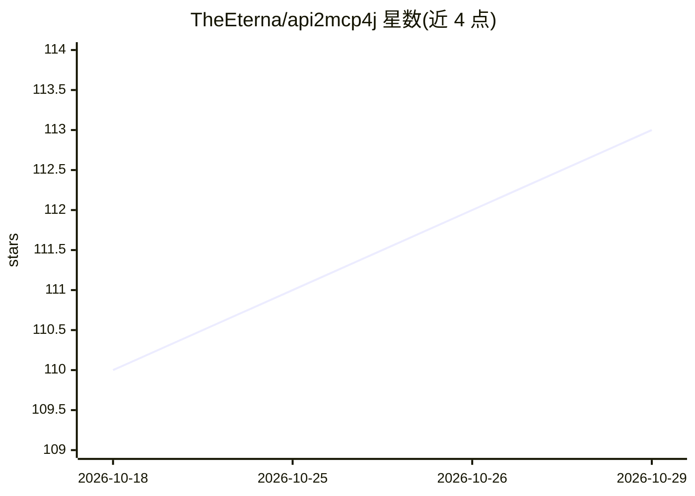

# TheEterna/api2mcp4j

⭐ 113 · Java · Apache-2.0 · 推送 2026-10-28 · [GitHub](https://github.com/TheEterna/api2mcp4j) · [官网](https://theeterna.github.io/server2mcp-docs/) · 个人维护 · 中文 README

**把 Spring Boot REST 控制器自动转为 MCP Server 的 Starter**

面向已有 Spring Boot 项目的 Maven Starter：扫描 @RestController Bean，将其方法注册为 MCP 工具，业务代码零改动。通过 Swagger v3/v2、Javadoc、Spring MVC、Jackson、Spring AI 五级解析链生成工具描述，支持自定义解析器扩展。实现 MCP 2026-07-28 协议的 JSON-RPC 路由、SSE 长轮询、MRTR 多轮状态机与 W3C traceparent，覆盖 Tools/Resources/Prompts/Completions 等能力。README 自称年轻项目，版本为 1.1.4-SNAPSHOT，尚未发布到 Maven Central，需源码构建安装。

## 筛选速览

| 维度 | 判定 | 备注 |
|---|---|---|
| AI 角色 | `ai-ecosystem` | LLM/agent 周边工具 |
| 许可风险 | `permissive` | Apache-2.0 |
| 部署形态 | `None` |  |
| 模型依赖 | — | README 未给出锁定关系 |
| 硬件要求 | — | 无带数字的原话,不猜 |
| 安装摩擦 | `low` | 无编译、无系统依赖或容器化 |
| 成熟度 | `idea` | |

## 能力要点

- 扫描 @RestController 自动注册为 MCP 工具，无需 @Tool 注解
- 五级解析链（Swagger v3/v2、Javadoc、Spring MVC、Jackson、Spring AI）生成描述
- MCP 2026-07-28 协议实现：JSON-RPC 路由、SSE 长轮询、MRTR 多轮、W3C traceparent
- 600+ 测试，提供端到端 curl 验证脚本

## 适用场景

- 把存量 REST API 快速暴露给 AI agent 调用
- 多 agent 系统共享统一的工具定义
- 在生产服务上原型化 AI 功能而不改业务代码

## 场景标签

`Agent 框架` · 领域:Agent 开发

## 证据(README 行号)

> L3: **Turn your existing Spring Boot REST controllers into MCP (Model Context Protocol) tools — no rewrites, no `@Tool` 
> L32: **api2mcp4j** scans your existing `@RestController` beans and exposes their methods as MCP tools — **zero changes t
> L45: |🎯 **Non-intrusive**|`interface` scope auto-registers all controllers; no `@Tool` annotation needed|

## 星数曲线

2026-10-18 110 → 2026-10-29 113（+3）

---
*卡片 v1 · prompt 1.4 · 生成 2026-10-23 · 置信度 high · 依据 README sha `42e21e21e6ff` · [字段定义](../../DATASET.md)*
