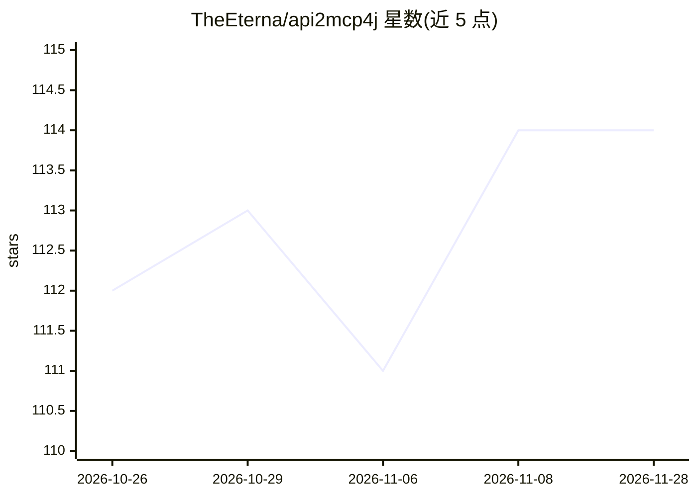

# TheEterna/api2mcp4j

⭐ 114 · Java · Apache-2.0 · 推送 2026-10-28 · [GitHub](https://github.com/TheEterna/api2mcp4j) · [官网](https://theeterna.github.io/server2mcp-docs/) · 个人维护 · 中文 README

**给 Spring Boot 开发者：零改动把现有 REST 控制器暴露为 MCP 工具**

一个 Spring Boot Starter 库，扫描已有的 @RestController Bean 并将其方法自动注册为 MCP（Model Context Protocol）工具，业务代码无需改动或添加 @Tool 注解。通过五级解析器链（Swagger v3/v2、Javadoc、Spring MVC、Jackson）生成工具描述，提供 WebMVC 与 WebFlux 两个 starter，覆盖 Tools/Resources/Prompts/Completions 等 MCP 能力，并实现自定义 JSON-RPC 路由与 SSE 长轮询。README 声明尚未发布到 Maven Central，目前需从源码构建。

## 筛选速览

| 维度 | 判定 | 备注 |
|---|---|---|
| AI 角色 | `ai-ecosystem` | LLM/agent 周边工具 |
| 许可风险 | `permissive` | Apache-2.0 |
| 部署形态 | `None` |  |
| 模型依赖 | — | README 未给出锁定关系 |
| 硬件要求 | — | 无带数字的原话,不猜 |
| 安装摩擦 | `low` | 无编译、无系统依赖或容器化 |
| 成熟度 | `idea` | |

## 能力要点

- 扫描 @RestController 自动注册为 MCP 工具，无需修改业务代码
- 5 解析器链生成工具描述（Swagger v3/v2 / Javadoc / Spring MVC / Jackson）
- 提供 WebMVC 与 WebFlux 两种 starter
- 覆盖 Tools / Resources / Prompts / Completions / Elicitation / Sampling / Roots

## 适用场景

- 把内部 REST API 快速暴露给 AI agent 调用
- 将遗留 Spring 控制器包装为 MCP 工具
- 多 agent 系统之间共享工具定义
- 在生产服务上快速原型化 AI 功能

## 场景标签

`Agent 框架` · 领域:Agent 开发

## 证据(README 行号)

> L3: **Turn your existing Spring Boot REST controllers into MCP (Model Context Protocol) tools — no rewrites, no `@Tool` 
> L32: **api2mcp4j** scans your existing `@RestController` beans and exposes their methods as MCP tools — **zero changes t

## 星数曲线

2026-10-26 112 → 2026-11-28 114（+2）

---
*卡片 v1 · prompt 1.4 · 生成 2026-11-28 · 置信度 high · 依据 README sha `23835b4d2574` · [字段定义](../../DATASET.md)*
