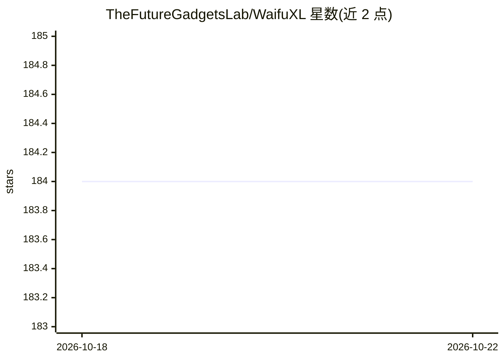

# TheFutureGadgetsLab/WaifuXL

⭐ 184 · TypeScript · Apache-2.0 · 推送 2026-02-03 · [GitHub](https://github.com/TheFutureGadgetsLab/WaifuXL) · [官网](https://waifuxl.com/) · 组织维护

**浏览器内本地运行的动漫图像超分辨率放大网站**

基于 Real-ESRGAN 超分辨率网络与 MobileNetV3 图像标签网络的网页应用，模型权重通过 ONNX Runtime 流式加载到用户设备，以 WebAssembly 本地执行，无需后端即静态网页提供服务，图像不上传服务器。模型在 Danbooru2021 约 120 万张动漫风格图像上训练，对真实照片效果有限。网站部署于 Cloudflare Pages，前端使用 React/Next.js/TailwindCSS，可克隆源码本地运行，主线分支当前不可用需切换 de_spaghetti 分支。

## 筛选速览

| 维度 | 判定 | 备注 |
|---|---|---|
| AI 角色 | `ai-native` | 本体是模型或模型工具 |
| 许可风险 | `permissive` | Apache-2.0 |
| 部署形态 | `library` | 以包/库形式分发 |
| 模型依赖 | — | README 未给出锁定关系 |
| 硬件要求 | — | 无带数字的原话,不猜 |
| 安装摩擦 | `low` | 无编译、无系统依赖或容器化 |
| 成熟度 | — | 结构信号不足 |

## 能力要点

- ONNX Runtime WebAssembly 在浏览器本地执行推理，图像不上传
- Real-ESRGAN 超分网络 + MobileNetV3 标签网络，训练于约 120 万张动漫图像
- 纯静态网页部署于 Cloudflare Pages，无模型执行后端

## 适用场景

- 在浏览器中免费放大动漫风格图片
- 不上传图片、本地完成图像超分处理
- 用标签网络自动识别图片中的动漫角色标签

## 场景标签

`图像视频处理` · 领域:感知与多模态

## 证据(README 行号)

> L19: Using the Onnx Runtime, we stream the weights of our ML models directly onto your device to be executed locally in 
> L23: For our super resolution network we are using the state-of-the-art Real-ESRGAN and for our image tagging network we

## 星数曲线

2026-10-18 184 → 2026-10-22 184（+0）

---
*卡片 v1 · prompt 1.4 · 生成 2026-10-22 · 置信度 high · 依据 README sha `157614d9c931` · [字段定义](../../DATASET.md)*
